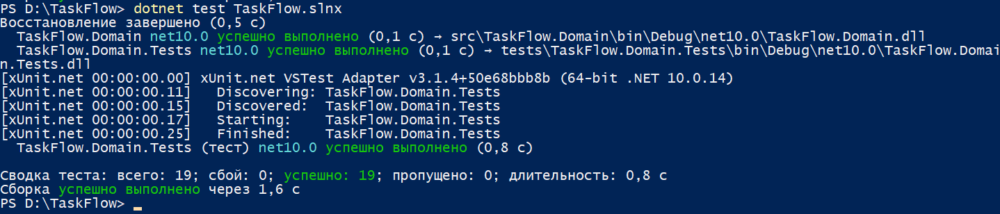
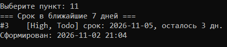
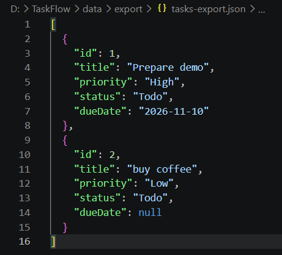

# Неделя 02: отчёт

## Что сделано

### Лабораторная
- Шаг 1: проверил состояние после недели 01, создал папки `Abstractions`, `Repositories`, `Services`, `Notifications`, `Reports`, добавил `data/` в `.gitignore`.
- Шаг 2: вынес `Id` и `CreatedAt` в абстрактный класс `BaseEntity`, `TaskItem` и `Project` теперь его наследники. Добавил `[JsonConstructor]`, `[JsonInclude]` и `[JsonIgnore]` для работы с JSON.
- Шаг 3: интерфейс `ITaskRepository` и реализация в памяти `InMemoryTaskRepository`.
- Шаг 4: `JsonFileTaskRepository`, который хранит задачи в `data/tasks.json` и внутри использует `InMemoryTaskRepository` (композиция).
- Шаг 5: интерфейс `INotifier` и три реализации: `ConsoleNotifier`, `FileNotifier`, `CompositeNotifier`.
- Шаг 6: `ITaskService` и `TaskService` с правилами: срок не в прошлом, не больше 3 задач в работе, понятная ошибка для несуществующего Id, уведомление о каждом изменении. Все зависимости приходят через конструктор.
- Шаг 7: абстрактный `TaskReport` (шаблонный метод) и наследники `OverdueReport`, `ByPriorityReport`.
- Шаг 8: новый `Program.cs` как composition root, запуск с ключом `--memory` подставляет хранилище в памяти без изменений в `TaskService`. Удалил файлы консоли недели 01 (`ProjectMenu.cs`, `TaskQueries.cs`, `ConsoleInput.cs`, `TypesDemo.cs`), их работу теперь делают сервис и репозиторий.
- Шаг 9: тестовый проект `TaskFlow.Domain.Tests`, подделки `FixedTimeProvider` и `RecordingNotifier`, 5 тестов. Проверил, что при закомментированной строке `CompletedAt = now;` падают 2 теста.

### Домашнее задание
- Задание 1: отчёт `DueSoonReport` (задачи со сроком в ближайшие 7 дней, строка заканчивается на «осталось N дн.»), пункт меню 11. Файлы `TaskReport.cs`, `OverdueReport.cs`, `ByPriorityReport.cs` не менялись.
- Задание 2: метод `Filter(TaskItemStatus? status, TaskPriority? priority)` в `ITaskService` и `TaskService`, одно LINQ-выражение на `Where`, пункт меню 12. Пустой ввод означает «любой».
- Задание 3: `TaskExportRow` и `TaskExporter` (через `Select` и `JsonSerializerDefaults.Web`, имена в camelCase), пункт меню 13 записывает `data/export/tasks-export.json`.
- Задание 4: 9 новых тестовых методов, всего в `dotnet test` 19 тестов, все проходят:
  - `TaskItemTests`: `[Theory]` для `IsOverdue` с 4 наборами `[InlineData]`, `Reopen` для задачи в статусе Todo;
  - `TaskServiceTests`: лимит задач в работе, поиск без учёта регистра, удаление несуществующего Id, фильтр по Todo;
  - `InMemoryTaskRepositoryTests`: Id выдаются подряд 1, 2, 3;
  - `ReportTests`: `DueSoonReport` включает задачу через 3 дня и не включает задачу через 10 дней.

### Бонус
- Обобщённый репозиторий: `IRepository<T> where T : BaseEntity` и `InMemoryRepository<T>`. `ITaskRepository` наследует `IRepository<TaskItem>`, `InMemoryTaskRepository` наследует `InMemoryRepository<TaskItem>`. Старые тесты проходят без изменений.
- Декоратор `LoggingTaskRepository`: содержит другой `ITaskRepository` и через `INotifier` сообщает о каждом добавлении, обновлении и удалении. Подключается одной строкой в `Program.cs` (строка 24).
- Репозиторий проектов: `IProjectRepository` и `InMemoryProjectRepository`, пункты меню 14 «Создать проект» и 15 «Список проектов». При создании задачи можно указать Id проекта, несуществующий проект даёт ошибку. Для этого в `Create` добавлен необязательный параметр `projectId`.
- Тест с `[MemberData]`: `Constructor_WithInvalidTitle_ThrowsArgumentException` проверяет три некорректных названия (пустое, из пробелов, длиннее 200 символов).

## Таблица SOLID

| Буква | Класс | Файл | Почему принцип соблюдается |
|---|---|---|---|
| S | `TaskExporter` | `src/TaskFlow.Domain/Services/TaskExporter.cs` | Класс отвечает только за превращение задач в JSON для внешних систем, правила и хранение его не касаются. |
| O | `DueSoonReport` | `src/TaskFlow.Domain/Reports/DueSoonReport.cs` | Новый отчёт добавлен новым классом-наследником `TaskReport`, а `TaskReport`, `OverdueReport` и `ByPriorityReport` не изменились. |
| L | `JsonFileTaskRepository` | `src/TaskFlow.Domain/Repositories/JsonFileTaskRepository.cs` | Его можно подставить вместо `InMemoryTaskRepository`, и `TaskService` работает так же (ключ `--memory` переключает их без изменений в сервисе). |
| I | `INotifier` | `src/TaskFlow.Domain/Abstractions/INotifier.cs` | В интерфейсе один метод `Notify`, поэтому ни одной реализации не приходится писать заглушки. |
| D | `TaskService` | `src/TaskFlow.Domain/Services/TaskService.cs` | Сервис получает `ITaskRepository`, `INotifier` и `TimeProvider` через конструктор и сам не создаёт конкретные классы. |

## Какие строки нужно изменить, чтобы хранить задачи в другом месте

Только строки **21–23** в `src/TaskFlow.ConsoleApp/Program.cs`:

```csharp
ITaskRepository repository = useMemory
    ? new InMemoryTaskRepository()
    : new JsonFileTaskRepository(Path.Combine(dataFolder, "tasks.json"));
```

Нужно написать новый класс, который реализует `ITaskRepository` и создать его здесь вместо `JsonFileTaskRepository`. `TaskService`, отчёты, экспорт, меню и тесты менять не нужно, потому что они работают только через интерфейс `ITaskRepository`. Декоратор на строке 24 тоже продолжит работать, он оборачивает любой `ITaskRepository`.

## Затраченное время

| Часть | Часы |
|---|---|
| Теория | 2 |
| Лабораторная | 3 |
| Задание 1: `DueSoonReport` | 0,5 |
| Задание 2: фильтр | 1 |
| Задание 3: экспорт в JSON | 1 |
| Задание 4: тесты | 1,5 |
| Задание 5: отчёт и скриншоты | 0,5 |
| Бонус | 1 |
| **Итого** | **10,5** |

## Проблемы и как я их решил
- В LINQ-цепочке поставил `;` после `Where` и `OrderBy`, и сборка падала. Понял, что цепочка это одна команда и `;` ставится только после `ToList()`.
- `Assert.Equal` сравнивает строки точно, поэтому «Подготовить демо» и «Подготовить Демо» для него разные. Исправил ожидаемое значение.
- В старой консоли Windows русские названия задач при вводе превращались в `\u0000`. Причина в кодировке ввода консоли. Для проверки и скриншотов использовал латиницу.

## Ответы на вопросы для самопроверки

**1. Чем абстрактный класс отличается от интерфейса? Почему `TaskReport` абстрактный класс, а `INotifier` интерфейс?**

Абстрактный класс может содержать общий код, поля и конструктор, но унаследовать можно только один. Интерфейс это только список методов без кода, и реализовать можно сколько угодно. `TaskReport` абстрактный класс, потому что у всех отчётов общий алгоритм `Render` (заголовок, строки, подвал), а меняется только середина. `INotifier` интерфейс, потому что у консольного и файлового уведомителя нет общего кода, общее только умение `Notify`.

**2. Что произойдёт, если у метода наследника написать `new` вместо `override`?**

Метод не заменит метод родителя, а только спрячет его. Если вызвать метод через переменную базового типа, например `TaskReport report = new OverdueReport()`, вызовется старая версия из родителя. Компилятор при этом выдаст предупреждение CS0114.

**3. Почему `JsonFileTaskRepository` содержит `InMemoryTaskRepository`, а не наследуется от него?**

Потому что файловый репозиторий не является репозиторием в памяти, он хранит данные в файле. Он только поручает работу со списком и выдачу Id вложенному объекту, а сам читает и пишет файл. Это композиция: так классы меньше связаны, и каждый отвечает за своё.

**4. Приведите пример из TaskFlow для каждой буквы SOLID.**

S: `TaskService` отвечает за правила, `JsonFileTaskRepository` за файл, `ConsoleNotifier` за вывод. O: новый отчёт `DueSoonReport` добавлен новым классом, старые отчёты не менялись. L: `JsonFileTaskRepository` и `InMemoryTaskRepository` взаимозаменяемы для `TaskService`. I: в `INotifier` один метод. D: `TaskService` получает интерфейсы через конструктор.

**5. Что такое composition root и где он в TaskFlow на этой неделе?**

Это единственное место, где создаются конкретные классы и соединяются между собой. В TaskFlow это начало `Program.cs`: там создаются репозиторий, уведомители, часы и `TaskService`.

**6. Почему `TaskService` получает `TimeProvider`, а не вызывает `DateTime.Now`?**

Чтобы правила, которые зависят от даты, можно было проверить в тестах. В программе передаётся `TimeProvider.System`, а в тестах `FixedTimeProvider`, который всегда возвращает одну дату. С `DateTime.Now` тест мог бы пройти сегодня и упасть завтра.

**7. Чем `First()` отличается от `FirstOrDefault()`? Что вернёт `FirstOrDefault()` для `List<TaskItem>`, если ничего не найдено?**

`First()` бросает `InvalidOperationException`, если ничего не нашлось. `FirstOrDefault()` в этом случае возвращает значение по умолчанию, для `TaskItem` это `null`. Поэтому для поиска по Id используется `FirstOrDefault()` и проверка на `null`.

**8. Что такое отложенное выполнение LINQ? Когда запрос реально выполняется?**

`Where`, `Select`, `OrderBy` не выполняются сразу, а только запоминают, что нужно сделать. Запрос выполняется, когда результат реально нужен: при `foreach`, `ToList()`, `Count()`, `Any()`. Если список изменится до этого, результат тоже изменится, поэтому для «снимка» вызывают `ToList()`.

**9. Напишите LINQ-выражение, которое возвращает количество задач каждого приоритета.**

```csharp
Dictionary<TaskPriority, int> byPriority = tasks
    .GroupBy(t => t.Priority)
    .ToDictionary(g => g.Key, g => g.Count());
```

**10. Зачем нужны `[JsonInclude]`, `[JsonIgnore]` и `[JsonConstructor]` в `TaskItem`?**

`[JsonInclude]` разрешает сериализатору сохранять и читать `Status` и `CompletedAt`, хотя у них `private set`, иначе после перезапуска все задачи снова были бы Todo. `[JsonIgnore]` не даёт сохранять `Project`, иначе получился бы бесконечный цикл задача, проект, задача. `[JsonConstructor]` показывает, какой конструктор использовать при чтении файла, у нас это закрытый конструктор без параметров.

**11. Из каких трёх частей состоит тест? Как назвать тест, проверяющий, что `Reopen` на задаче в статусе Todo бросает исключение?**

Arrange (подготовка), Act (действие) и Assert (проверка). Такой тест можно назвать `Reopen_WhenTodo_ThrowsInvalidOperationException`, он есть в `TaskItemTests`.

**12. Почему в тестах `TaskService` используется `RecordingNotifier`, а не `ConsoleNotifier`?**

`ConsoleNotifier` печатает в консоль, и тест не может проверить, что было напечатано. `RecordingNotifier` запоминает сообщения в список, поэтому тест может проверить, что уведомление было (или не было) и что в нём написано. Подставить его можно, потому что `TaskService` зависит от интерфейса `INotifier`.

## Скриншоты
- `tests.png`: вывод `dotnet test`, 19 тестов, все успешны.



- `due-soon-report.png`: отчёт «Срок в ближайшие 7 дней» (пункт 11).



- `export-json.png`: содержимое `data/export/tasks-export.json`.



