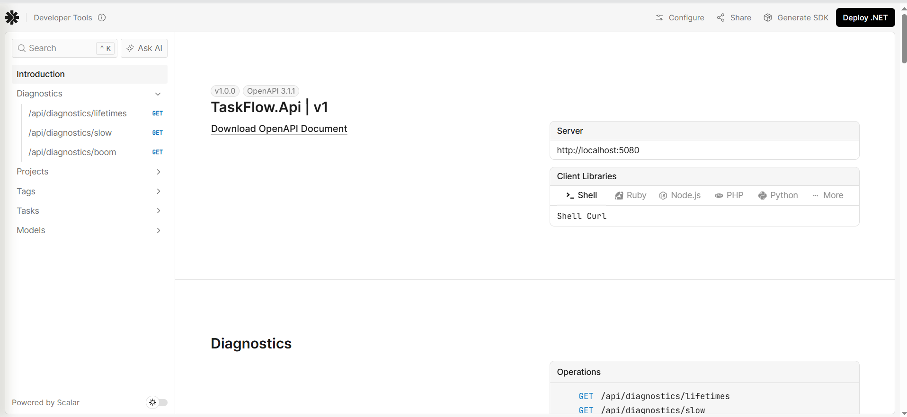
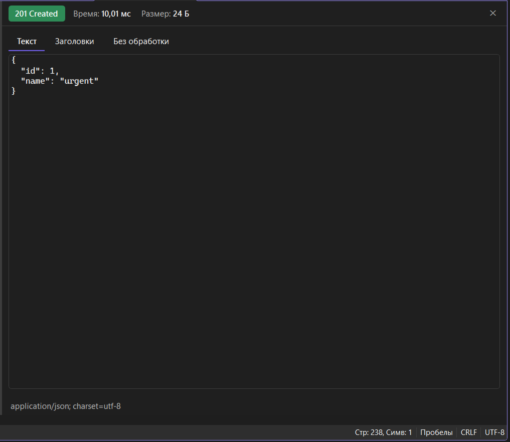
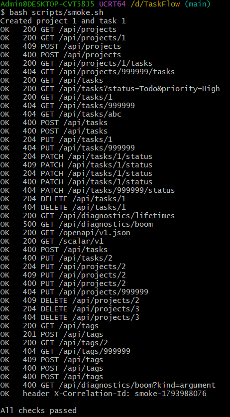
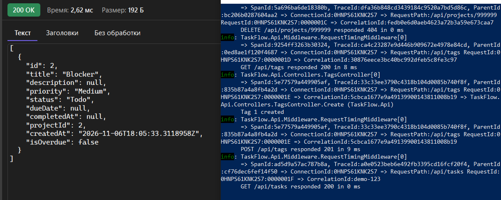

# Неделя 03: отчёт

## Что сделано

### Лабораторная
- Шаг 1: проверил состояние недели 02, вывел `TaskFlow.ConsoleApp` из решения (папка осталась в репозитории), добавил сущность `Tag`.
- Шаг 2: сделал асинхронные контракты: `ITaskRepository`, `IProjectRepository`, `TaskFilter`, `ITaskService`, `IProjectService`.
- Шаг 3: асинхронные `InMemoryTaskRepository` (с `lock`), `JsonFileTaskRepository` (с `SemaphoreSlim`), `InMemoryProjectRepository`, новые `TaskService` и `ProjectService`. Удалил бонус недели 02 (`IRepository<T>`, `InMemoryRepository<T>`, `LoggingTaskRepository`), потому что он был синхронным и не подходил к новому интерфейсу.
- Шаг 4: перевёл тесты на `async`, добавил `ProjectServiceTests`, переделал свой тест `InMemoryTaskRepositoryTests` на `AddAsync`.
- Шаг 5: проект `TaskFlow.Shared` с DTO.
- Шаг 6: проект `TaskFlow.Api`, пакет Scalar, один профиль `http` на порту 5080.
- Шаг 7: `RequestTimingOptions` и настройки в `appsettings.json` / `appsettings.Development.json`.
- Шаг 8: `RequestTimingMiddleware` (заголовок `X-Elapsed-Ms` через `OnStarting`) и `GlobalExceptionHandler`.
- Шаг 9: `Program.cs`, регистрация в DI, проверка Scalar, проверка валидации настроек при запуске и переопределения через переменную окружения.
- Шаг 10: ручной маппинг методами расширения (`TaskMappings`, `ProjectMappings`).
- Шаг 11: `TasksController` (GET, GET {id}, POST, PUT, PATCH статуса, DELETE).
- Шаг 12: `ProjectsController` (GET, GET {id}, POST, GET {id}/tasks).
- Шаг 13: диагностика времени жизни, captive dependency, отмены, ошибки 500 и порядка middleware (наблюдения ниже).
- Шаг 14: файл `.http`, проверка через Scalar, скрипт `scripts/smoke.sh`.

### Домашнее задание
1. **Проверка `ProjectId` у задачи.** В `TasksController` добавил `IProjectService` и приватный метод `ProjectExistsAsync`. Если `projectId` задан, а проекта нет, `POST` и `PUT` возвращают 400 `ValidationProblemDetails` с ключом `ProjectId`. Задача без проекта создаётся как раньше.
2. **Изменение и удаление проектов.** `UpdateProjectRequest`, методы `UpdateAsync` и `DeleteAsync` в `IProjectRepository` / `InMemoryProjectRepository` и в `IProjectService` / `ProjectService`, действия `PUT` и `DELETE` в `ProjectsController`. Конфликт имени проверяется по Id, поэтому переименование того же проекта в другой регистр разрешено. Удаление проекта с задачами даёт 409. Для этого в `ProjectService` внедрён `ITaskRepository`.
3. **Метки.** `TagDto`, `CreateTagRequest`, `ITagRepository` + `InMemoryTagRepository` (Singleton, с `lock`, список отсортирован по имени), `ITagService` + `TagService` (Scoped), `TagMappings`, `TagsController` (`GET`, `GET {id}`, `POST` с 201/400/409).
4. **`CorrelationIdMiddleware`.** Берёт `X-Correlation-Id` из запроса, если он не длиннее 64 символов и состоит только из латинских букв, цифр и `-`, иначе генерирует `Guid` в формате `N`. Возвращает заголовок в ответе через `OnStarting` и открывает область логирования на время запроса. Стоит в конвейере первым, в `appsettings.Development.json` включён `IncludeScopes`.
5. **`ArgumentExceptionHandler`.** Превращает `ArgumentException` (и наследников) в 400 с заголовком `Invalid argument`, для остальных исключений возвращает `false`. Зарегистрирован до `GlobalExceptionHandler`. Для проверки `GET /api/diagnostics/boom?kind=argument`.
6. **`DiagnosticsOptions`.** Секция `Diagnostics`, свойство `Enabled`, регистрация через `AddOptions().Bind().ValidateDataAnnotations().ValidateOnStart()`. В `appsettings.json` `false`, в `appsettings.Development.json` `true`. Если выключено, все три действия `DiagnosticsController` возвращают 404 (проверил запуском в Production).
7. **Тесты.** 12 новых тестов: 3 на переходы статуса (`InProgress -> Todo` бросает исключение, `Done -> Todo` сбрасывает `CompletedAt`, `InProgress -> Done` разрешён), 4 на `ProjectService` (переименование в другой регистр, конфликт имени, удаление с задачами, удаление пустого проекта), 3 на `TagService` (Id и `CreatedAt`, дубликат без учёта регистра, сортировка по имени). Всего `dotnet test` показывает 32 теста, все проходят.
8. **Проверки API.** `TaskFlow.Api.http` дополнен запросами 18–37 для всех новых конечных точек, включая 400/404/409. `scripts/smoke.sh` дополнен проверками задачи с несуществующим проектом, PUT/DELETE проектов, меток, `boom?kind=argument` и заголовка `X-Correlation-Id`. Скрипт заканчивается `All checks passed`.

## Затраченное время

| Часть | Часы |
|---|---|
| Теория | 2 |
| Лабораторная | 4 |
| Требование 1: проверка `ProjectId` | 0,5 |
| Требование 2: изменение и удаление проектов | 1,5 |
| Требование 3: метки | 1 |
| Требование 4: `CorrelationIdMiddleware` | 0,5 |
| Требование 5: `ArgumentExceptionHandler` | 0,5 |
| Требование 6: `DiagnosticsOptions` | 0,5 |
| Требование 7: тесты | 0,5 |
| Требование 8: `.http` и `smoke.sh` | 0,5 |
| Отчёт и скриншоты | 0,5 |
| **Итого** | **12** |

## Проблемы и как я их решил
- После перехода на асинхронный `ITaskRepository` перестал собираться `LoggingTaskRepository` из бонуса недели 02 (ошибки CS0535). Удалил его и неиспользуемые `IRepository<T>`, `InMemoryRepository<T>`.
- Перестал собираться мой тест `InMemoryTaskRepositoryTests` (нет метода `Add`). Сделал тест `async` и заменил вызовы на `await AddAsync`.
- После добавления `ITaskRepository` в конструктор `ProjectService` перестал собираться `ProjectServiceTests`, добавил репозиторий задач в создание сервиса.

## Почему порядок регистрации обработчиков исключений важен

Обработчики `IExceptionHandler` вызываются по очереди в порядке регистрации, пока один из них не вернёт `true`. `GlobalExceptionHandler` обрабатывает любое исключение и всегда возвращает `true`. Если зарегистрировать его первым, до `ArgumentExceptionHandler` очередь не дойдёт никогда, и `ArgumentException` тоже превратится в 500. Поэтому сначала регистрируется узкий обработчик (`ArgumentExceptionHandler`), который берёт только свои исключения и для остальных возвращает `false`, а последним глобальный, как «страховка» для всего остального. Я сам на это наткнулся, когда в `Program.cs` осталась старая регистрация глобального обработчика выше нового.

## Наблюдения шага 13 лабораторной

**Время жизни сервисов.** Два запроса к `/api/diagnostics/lifetimes`: `transient` разный даже внутри одного запроса (контроллер и `OperationReporter` получили разные объекты), `scoped` одинаковый внутри запроса, но новый во втором запросе, `singleton` одинаковый всегда.

**Captive dependency.** Когда `SingletonOperation` получил в конструкторе `ScopedOperation`, приложение в Development упало при запуске с ошибкой `Cannot consume scoped service 'ScopedOperation' from singleton 'SingletonOperation'`. В Production то же самое запустилось без ошибки: проверка областей там выключена, и Scoped-объект молча живёт всё время работы приложения. Поэтому важно запускать в Development и читать сообщения при старте.

**Отмена запроса.** Запрос `/api/diagnostics/slow?seconds=10`, прерванный через 2 секунды, дал в логе `Slow request ... responded 499`, а строки `Slow request finished` не было: `Task.Delay` получил отменённый `CancellationToken` и прервался. `GlobalExceptionHandler` при этом не вызывался. Без прерывания запрос `?seconds=2` вернул 200.

**Ошибка 500.** `/api/diagnostics/boom` вернул 500 и `ProblemDetails` с `traceId`, без текста исключения. Полный текст и стек есть только в логе сервера (`Unhandled exception for GET /api/diagnostics/boom`).

**Порядок middleware.** Когда замер времени стоял после `UseExceptionHandler()`, клиент получал 500, а в логе замера было `responded 200`: блок `finally` выполнялся, пока исключение ещё летело вверх и код 500 ещё не был установлен. После возврата правильного порядка (сначала замер, потом обработчик ошибок) в логе стал виден настоящий код 500.

## Ответы на вопросы для самопроверки

**1. Чем отличаются PUT и PATCH? Какой из них идемпотентен по определению?**

PUT заменяет ресурс целиком, клиент присылает его полное новое состояние. PATCH меняет только часть ресурса, например только статус. По определению идемпотентен PUT: если повторить один и тот же PUT, состояние будет то же самое. PATCH может быть идемпотентным, а может и нет, это зависит от реализации (у нас повторный PATCH в тот же статус даёт 409).

**2. Почему на неверные данные клиента нужно возвращать 400, а на недопустимый переход статуса 409?**

400 означает, что сам запрос неправильный по форме: пустое название, неизвестный приоритет, нет обязательного поля. 409 означает, что запрос правильный, но противоречит текущему состоянию ресурса: например, задачу, которая уже в работе, нельзя снова начать. В первом случае клиент должен исправить данные, во втором выбрать другое действие.

**3. Что произойдёт с потоком сервера во время `await repository.GetAllAsync(ct)`? Почему `.Result` опасен в веб-приложении?**

Пока идёт ожидание, поток не стоит, а возвращается в пул и может обслуживать другие запросы. Когда результат готов, метод продолжается. `.Result` наоборот блокирует поток до получения результата. Под нагрузкой много потоков стоят и ждут, пул потоков заканчивается, и запросы начинают «зависать».

**4. Откуда в действии контроллера берётся `CancellationToken` и когда он отменяется?**

ASP.NET Core сам создаёт токен для каждого запроса (`HttpContext.RequestAborted`) и передаёт его, если в действии есть параметр `CancellationToken`. Токен отменяется, когда клиент закрыл соединение, то есть результат больше никому не нужен.

**5. Из каких источников привязывается каждый параметр действия `ChangeStatus(int id, [FromBody] ChangeStatusRequest request, CancellationToken cancellationToken)` для `PATCH /api/tasks/7/status`?**

`id` берётся из маршрута (`7` из адреса). `request` из тела запроса в формате JSON (`[FromBody]`). `cancellationToken` не из запроса, его подставляет сам ASP.NET Core, это токен отмены текущего запроса.

**6. Назовите три причины не возвращать сущность `TaskItem` из API.**

Первая: overposting, клиент мог бы прислать `"status": "Done"` или `"id"` и обойти правила домена. Вторая: стабильный контракт, переименование свойства сущности не должно ломать клиента. Третья: циклы и лишние данные, например `Project.Tasks[0].Project...` при сериализации и внутренние поля, которые не должны уходить наружу.

**7. Почему `[Required]` на свойстве `TaskItemStatus Status` не работает и как это исправить?**

`TaskItemStatus` это значимый тип, у него всегда есть значение по умолчанию (`Todo`). Если поле не прислали, туда попадёт `Todo`, и `[Required]` решит, что значение есть. Исправить можно, сделав свойство nullable: `TaskItemStatus? Status` с `[Required]`. Тогда отсутствующее поле будет `null`, и валидация вернёт 400.

**8. Объясните Singleton/Scoped/Transient. Почему `InMemoryTaskRepository` Singleton, а `TaskService` Scoped?**

Singleton это один объект на всё приложение, Scoped один объект на HTTP-запрос, Transient новый объект при каждом внедрении. `InMemoryTaskRepository` Singleton, потому что он хранит задачи в памяти, и они должны жить между запросами (иначе каждый запрос видел бы пустой список). `TaskService` Scoped, потому что у него нет своего состояния и ему достаточно жить в пределах одного запроса; на неделе 5 он будет работать с `DbContext`, который тоже Scoped.

**9. Что такое captive dependency и почему приложение в Production запускается без ошибки, а в Development падает?**

Это когда Singleton получает в конструкторе Scoped-сервис. Singleton создаётся один раз, и Scoped-объект внутри него тоже остаётся одним на всё приложение, то есть «захвачен». В Development ASP.NET Core при запуске проверяет граф зависимостей и падает с понятной ошибкой. В Production эта проверка выключена ради скорости запуска, поэтому ошибка остаётся незамеченной.

**10. В каком порядке применятся значения `RequestTiming:SlowRequestThresholdMs` из `appsettings.json`, `appsettings.Development.json` и переменной окружения?**

Сначала `appsettings.json`, потом `appsettings.Development.json`, потом переменная окружения (`RequestTiming__SlowRequestThresholdMs`). Каждый следующий источник перекрывает предыдущий, поэтому побеждает переменная окружения. У меня в Development было 200 из файла окружения вместо 500 из базового, а с переменной `=1` любой запрос логировался как медленный.

**11. Почему middleware замера времени стоит перед `UseExceptionHandler()`?**

Чтобы обработчик ошибок оказался внутри замера, и в лог попадал итоговый код ответа. Если замер стоит после обработчика (внутри него), то при исключении блок `finally` замера выполняется раньше, чем обработчик выставит код 500, и в лог попадает 200. Я это проверил на шаге 13.

**12. Что получает клиент при необработанном исключении и где разработчик ищет подробности?**

Клиент получает 500 и `ProblemDetails` с общим заголовком `An unexpected error occurred.` и `traceId`, без текста исключения и стека, чтобы не раскрывать внутренние детали. Подробности (тип исключения, сообщение, стек) разработчик ищет в логе сервера, по `traceId` или по `CorrelationId` запроса.

## Скриншоты
- `scalar.png`: Scalar со всеми группами операций (Diagnostics, Projects, Tags, Tasks).

- `http-file.png`: выполнение запросов файла `TaskFlow.Api.http`.

- `smoke.png`: вывод `bash scripts/smoke.sh`, все проверки `OK`, `All checks passed`.

- `correlation-log.png`: строка лога замера времени с `CorrelationId:demo-123`.

