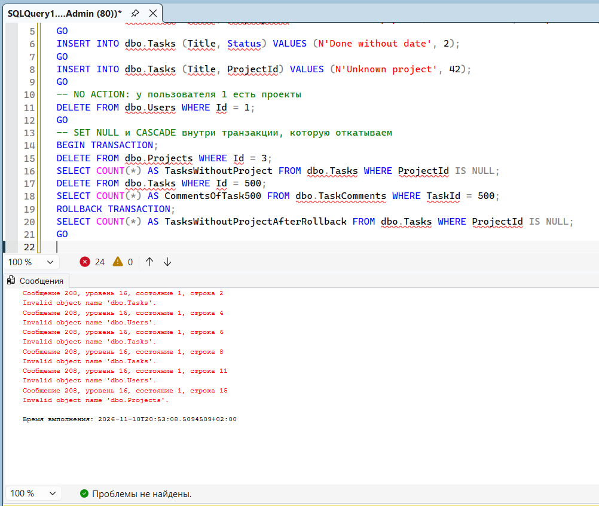
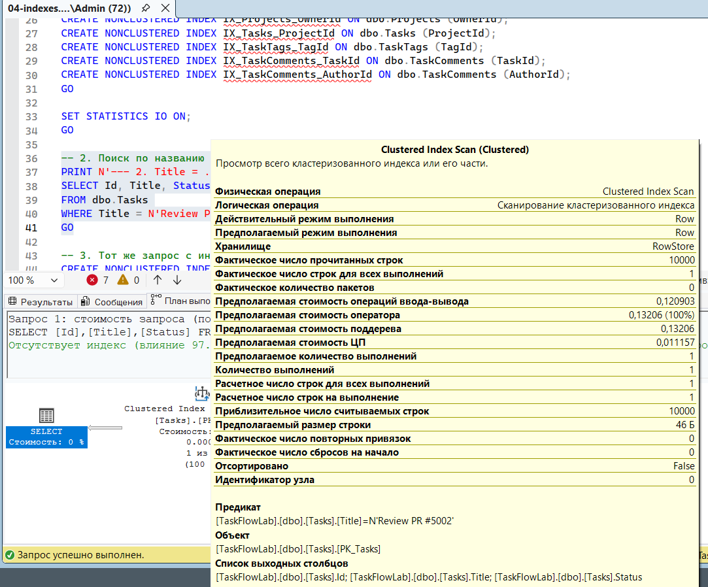
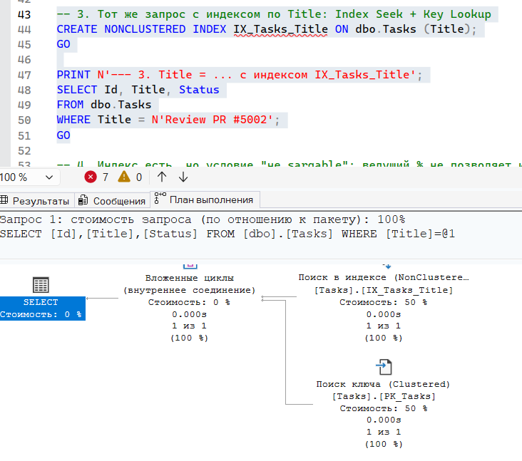
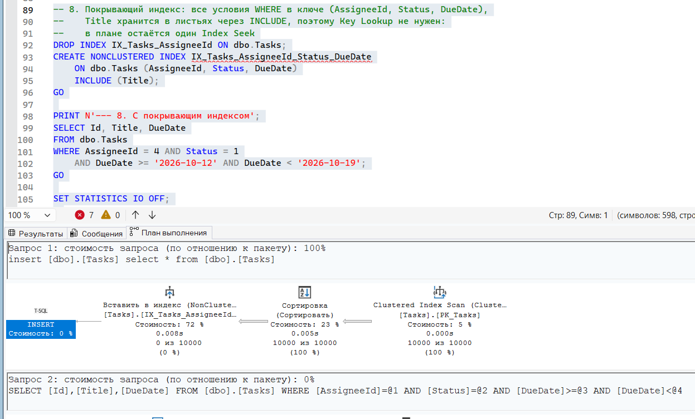
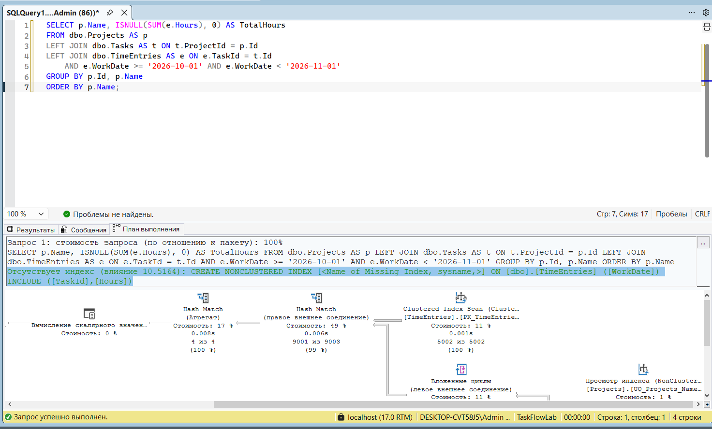
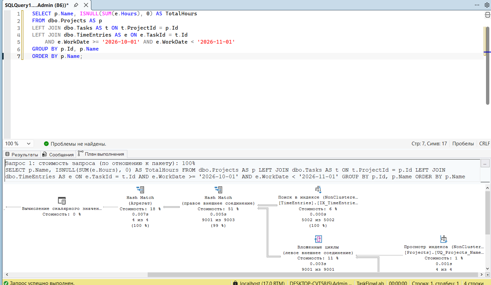

# Неделя 04: отчёт
## Что сделано

### Лабораторная
- Шаг 1: проверил подключение через sqlcmd и SSMS, создал папки `database` и `submissions/week-04`.
- Шаг 2: `01-schema.sql` создаёт базу TaskFlowLab и 6 таблиц с именованными PK, FK (NO ACTION, SET NULL, CASCADE), UNIQUE, CHECK и DEFAULT.
- Шаг 3: `02-seed.sql` заполняет базу: 6 пользователей, 4 проекта, 6 меток, 10 000 задач одним `INSERT ... SELECT`, 12 500 связей, 220 комментариев. Проверил все пять ограничений (скриншот `constraints.png`): CHECK приоритета, UNIQUE email, CHECK даты завершения, FK проекта, NO ACTION владельца. Внутри откатанной транзакции SET NULL дал 4000 задач без проекта, CASCADE удалил комментарии задачи 500, после ROLLBACK снова 1000.
- Шаг 4: `03-queries.sql` с запросами Q1-Q13 и представлением `vw_TaskDetails`. Вывод совпал с ожидаемым. Проверил, что с `COUNT(*)` в Q4 у Archive 2025 получается 1 вместо 0. Написал запрос «количество задач по меткам»: backend, bug, docs по 2500, feature 1667, frontend 1666, urgent 1667.
- Шаг 5: `04-indexes.sql`, индексы на FK, сравнение Scan и Seek, покрывающий индекс (таблица ниже, скриншоты `plan-scan.png`, `plan-seek-lookup.png`, `plan-covering.png`).
- Шаг 6: `05-procedures.sql`, процедуры `usp_CreateTask`, `usp_CompleteTask` (транзакция с откатом при ошибке 547), `usp_SearchTasks` (инъекция не сработала, задач осталось 10 001), пользователь `TaskFlowApp` (прямой доступ к таблице даёт ошибку 229, представление и процедура работают).
- Шаг 7: `database/ERD.md` с диаграммой Mermaid. Финальная проверка: все скрипты `exit code 0`, итог `6 10001 221 4 1 3`.

### Планы выполнения лабораторной (шаг 5)

| Блок | Запрос | Оператор в плане | logical reads |
|---|---|---|---|
| 2 | `Title = ...` без индекса | Clustered Index Scan (PK_Tasks) | 161 |
| 3 | `Title = ...` с `IX_Tasks_Title` | Index Seek (IX_Tasks_Title) + Key Lookup (PK_Tasks) | 4 |
| 4 | `LIKE N'%#5002'` | Index Scan (IX_Tasks_Title) | 58 |
| 5 | `LIKE N'Review PR #500%'` | Index Seek (IX_Tasks_Title) | 2 |
| 6 | AssigneeId + Status + DueDate без индекса | Clustered Index Scan (PK_Tasks) | 161 |
| 7 | с индексом только по AssigneeId | Clustered Index Scan (PK_Tasks), индекс не используется | 161 |
| 8 | с покрывающим индексом | Index Seek (IX_Tasks_AssigneeId_Status_DueDate) | 2 |

В блоке 7 индекс по `AssigneeId` находит около 900 задач пользователя 4. Для каждой пришлось бы делать Key Lookup за `Title`, `Status` и `DueDate`, а это дороже, чем прочитать всю таблицу (161 страница). Поэтому оптимизатор выбрал Scan. В блоке 8 все нужные колонки есть в индексе, Key Lookup не нужен, и читается 2 страницы вместо 161.

### Домашнее задание
1. **Нормализация.** `database/normalization.md`: выгрузка из Excel пошагово приведена к 3НФ. Для каждой формы указано нарушенное правило, зависимости вида `A -> B` и получившиеся таблицы. Итог совпадает со схемой: переиспользуются Users, Projects и Tasks, добавлены TimeEntries, Activities и TimeEntryActivities.
2. **Схема.** В `06-homework.sql` три новые таблицы со всеми именованными ограничениями.
   - `TimeEntries`: `CHECK (Hours > 0 AND Hours <= 24)` и `UNIQUE (TaskId, UserId, WorkDate)`. FK на Tasks с CASCADE (нет задачи, не нужны и её часы), FK на Users с NO ACTION (нельзя удалить сотрудника, у которого есть часы).
   - `Activities`: справочник видов работы с UNIQUE по имени.
   - `TimeEntryActivities`: связь N:M с составным PK и CASCADE с обеих сторон.
   - В начале скрипта `DROP TABLE IF EXISTS` от дочерней таблицы к родительским, поэтому скрипт можно запускать повторно.
3. **Данные.** 6 видов работы, 5000 записей времени одним `INSERT ... SELECT` с CTE чисел (задача `n`, пользователь `n % 5 + 1`, дата `1 + n % 31` октября, часы от 0.25 до 8.00), 6000 связей (у каждой записи один вид работы, у каждой пятой два). Циклов и курсоров нет.
4. **Восемь запросов** с комментарием-вопросом над каждым (ожидаемые результаты ниже).
5. **Представление `vw_UserWorkload`.** Для каждого пользователя считает открытые задачи, просроченные на 2026-10-31 и часы за 30 дней до этой даты. Задачи и часы сначала агрегируются в подзапросах, потом присоединяются к Users через LEFT JOIN, чтобы строки не размножались и Guest User попал в результат с нулями.
6. **Процедуры.**
   - `usp_LogTime` проверяет через THROW, что задача существует и не Done, пользователь существует, дата указана и часы больше 0 и не больше 24. Новый Id возвращается через OUTPUT-параметр.
   - `usp_MoveProjectTasks` переносит незавершённые задачи одним `UPDATE ... OUTPUT inserted.Id INTO @Moved` и добавляет комментарии одним `INSERT ... SELECT` в одной транзакции. Используются `SET XACT_ABORT ON`, TRY/CATCH, ROLLBACK и `THROW;`. Число перенесённых задач возвращается через необязательный OUTPUT-параметр `@MovedCount`.
7. **Индексы.**
   - На FK новых таблиц: `IX_TimeEntries_UserId` и `IX_TimeEntryActivities_ActivityId`.
   - Под запросы: `IX_TimeEntries_WorkDate (WorkDate) INCLUDE (TaskId, Hours)` для 4.1 и `IX_Tasks_Status (Status) INCLUDE (Title)` для 4.3.
   - Скриншоты: `hw-plan-before.png` и `hw-plan-after.png`.
8. **Права.** `TaskFlowApp` получил только EXECUTE на две новые процедуры и SELECT на `vw_UserWorkload`. Проверка от его имени: прямой SELECT из TimeEntries даёт ошибку 229, `usp_LogTime` работает, представление читается.
9. **Повторяемость.** Цикл 01-06 с `-b` выполнен два раза подряд, все 12 запусков `exit code 0`. `dotnet build` проходит, `dotnet test` 32 из 32.
10. **ERD.** `database/ERD.md` дополнен таблицами TimeEntries, Activities, TimeEntryActivities и четырьмя связями, всего 9 таблиц.

## Ожидаемые результаты запросов домашнего задания

Результаты для запуска 01-06 на чистой базе. Запросы 4.1-4.8 выполняются до демонстрации процедур, поэтому перенос задач в 6.3 на них не влияет.

**4.1 Часы по каждому проекту за октябрь 2026, включая проекты без часов**

| Project | TotalHours |
|---|---|
| Archive 2025 | 0.00 |
| Internal Tools | 6195.00 |
| Mobile App | 6206.50 |
| Website | 6199.50 |

**4.2 Топ-3 сотрудника по сумме часов**

| UserName | TotalHours |
|---|---|
| Ana Popescu | 4123.00 |
| Ștefan Țurcanu | 4123.00 |
| Maria Ceban | 4121.00 |

**4.3 Задачи в работе без списаний времени.** Всего 1667. Первые пять: 5002 Review PR #5002, 5005 Write docs #5005, 5008 Fix bug #5008, 5011 Deploy build #5011, 5014 Review PR #5014.

**4.4 Сотрудники, у которых в среднем больше 6 часов в день** (сумма часов, делённая на число разных дней)

| UserName | AvgHoursPerDay |
|---|---|
| Ana Popescu | 133.00 |
| Ștefan Țurcanu | 133.00 |
| Maria Ceban | 132.94 |
| Ion Rusu | 132.87 |
| Анна Петрова | 132.81 |

Значения нереальные, потому что данные учебные: 5000 записей на 5 человек за один месяц, примерно 32 записи на человека в день. Guest User без часов в результат не попадает.

**4.5 Сумма часов по неделям октября (неделя с понедельника)**

| WeekStart | TotalHours |
|---|---|
| 2026-09-28 | 2651.75 |
| 2026-10-05 | 4643.75 |
| 2026-10-12 | 4646.25 |
| 2026-10-19 | 4658.50 |
| 2026-10-26 | 4002.75 |

1 октября 2026 это четверг, поэтому первая неделя начинается 28 сентября и в неё попадают только 1-4 октября.

**4.6 Проекты, где доля выполненных задач меньше 40%**

| Project | TotalTasks | DoneTasks | DonePercent |
|---|---|---|---|
| Internal Tools | 3000 | 1000 | 33.33 |
| Mobile App | 3000 | 1000 | 33.33 |
| Website | 3001 | 1001 | 33.36 |

В Website на одну задачу больше из-за `usp_CreateTask` и одна лишняя выполненная из-за `usp_CompleteTask` в 05-procedures.sql. Archive 2025 без задач не попадает (деление на ноль убрано через `NULLIF`).

**4.7 Пять задач с наибольшим числом комментариев**

| Title | CommentCount |
|---|---|
| Fix bug #500 | 2 |
| Fix bug #1000 | 2 |
| Fix bug #1500 | 2 |
| Fix bug #2000 | 2 |
| Fix bug #2500 | 2 |

`LastCommentAt` равен времени запуска 02-seed.sql (комментарии получают `SYSUTCDATETIME()`), поэтому у каждого запуска своё значение.

**4.8 Запрос 4.1, вторая страница по 2 строки:** Mobile App 6206.50, Website 6199.50.

**Представление `vw_UserWorkload`**

| UserId | DisplayName | OpenTasks | OverdueTasks | HoursLast30Days |
|---|---|---|---|---|
| 1 | Ana Popescu | 2284 | 1427 | 3983.25 |
| 2 | Ștefan Țurcanu | 1144 | 715 | 3991.00 |
| 3 | Анна Петрова | 1144 | 720 | 3985.00 |
| 4 | Ion Rusu | 571 | 235 | 3987.00 |
| 5 | Maria Ceban | 572 | 472 | 3989.00 |
| 6 | Guest User | 0 | 0 | 0.00 |

**Демонстрация процедур**
- 6.1 `usp_LogTime` для задачи 5002: создана запись с Id 5001.
- 6.2 `usp_LogTime` для выполненной задачи 1: `Ошибка 50102: Task is already completed.`
- 6.3 `usp_MoveProjectTasks` из проекта 3 в проект 4: перенесено 2000 задач, в проекте 3 открытых не осталось, добавлено 2000 комментариев `Moved from project Internal Tools`.
- 6.4 `usp_MoveProjectTasks` из проекта 2 с несуществующим автором 999: `Ошибка 547`, задач в проекте 2 до 3000 и после 3000. UPDATE успел выполниться, но INSERT комментария упал на FK, и ROLLBACK вернул задачи на место.
- 8. От имени `TaskFlowApp`: `Прямой SELECT из TimeEntries: ошибка 229`, `LoggedViaProcedure = yes`, `UsersInWorkload = 6`, после REVERT снова `dbo`.

## Анализ индексов домашнего задания

Для запроса 4.3 замерялся вариант с `COUNT(*)`. С `FETCH NEXT 5 ROWS` SQL Server останавливается после пяти найденных строк, и число чтений зависит от того, где они лежат.

| Запрос | | Оператор в плане | logical reads |
|---|---|---|---|
| 4.1 | до | Clustered Index Scan (PK_TimeEntries) | TimeEntries 45 |
| 4.1 | после | Index Seek (IX_TimeEntries_WorkDate) | TimeEntries 16 |
| 4.3 | до | Index Scan (IX_Tasks_AssigneeId_Status_DueDate) | Tasks 75 |
| 4.3 | после | Index Seek (IX_Tasks_Status) | Tasks 22 |

- **4.1.** До индекса SQL Server читал всю таблицу записей времени и сам предлагал индекс `(WorkDate) INCLUDE (TaskId, Hours)` (зелёная подсказка на `hw-plan-before.png`). После его создания поиск идёт по дате, а `TaskId` и `Hours` берутся из индекса, без Key Lookup. Чтения упали с 45 до 16.
- **4.3.** До индекса задачи читались через `IX_Tasks_AssigneeId_Status_DueDate`: в нём есть `Status` и `Title`, но первая колонка `AssigneeId`, поэтому искать по статусу нельзя, только читать индекс целиком (75 страниц, вся таблица 161). Индекс только по `Status` был бы бесполезен из-за трёх значений, но с `INCLUDE (Title)` он покрывающий, и чтения упали с 75 до 22. Задачи без записей ищутся через Merge Join (анти-полусоединение) с `UQ_TimeEntries_Task_User_Date`, оба индекса уже отсортированы по Id задачи. У TimeEntries 15 чтений и до, и после.

**Индексы на FK новых таблиц:**
- `IX_TimeEntries_UserId` и `IX_TimeEntryActivities_ActivityId` созданы.
- `TimeEntries.TaskId` покрыт уникальным индексом `UQ_TimeEntries_Task_User_Date`, он начинается с `TaskId`.
- `TimeEntryActivities.TimeEntryId` первая колонка `PK_TimeEntryActivities`.

**Индекс, который я сознательно не создал:** `IX_TimeEntries_TaskId`. Он дублировал бы `UQ_TimeEntries_Task_User_Date`, у которого `TaskId` уже первая колонка. Запросы по `TaskId` (NOT EXISTS в 4.3, JOIN в 4.1, проверка FK при удалении задачи) используют уникальный индекс, что видно по одинаковым 15 чтениям в 4.3. Лишний индекс только замедлял бы каждый INSERT и UPDATE в TimeEntries и занимал бы место.

## Затраченное время

| Часть | Часы |
|---|---|
| Теория | 3 |
| Лабораторная: шаг 1 (окружение) | 0,5 |
| Лабораторная: шаги 2-3 (схема, данные, ограничения) | 0,5 |
| Лабораторная: шаг 4 (запросы) | 0,5 |
| Лабораторная: шаг 5 (индексы, планы) | 1 |
| Лабораторная: шаги 6-7 (процедуры, ERD, проверка) | 0,5 |
| ДЗ: нормализация | 1 |
| ДЗ: схема и данные | 0,5 |
| ДЗ: запросы и представление | 1,5 |
| ДЗ: процедуры | 1 |
| ДЗ: индексы, права, повторяемость, ERD | 1 |
| Отчёт и скриншоты | 1 |
| **Итого** | **12** |

## Проблемы и как я их решил
- **Версия SQL Server.** Установлен SQL Server 2025 вместо 2022. Совместимость проверил прогоном всех скриптов, всё работает.
- **Деление на ноль в 4.6.** Получил `Divide by zero error` у проекта без задач. Условие `TotalTasks > 0` не помогло, потому что SQL Server не обязан проверять условия WHERE слева направо. Заменил делитель на `NULLIF(s.TotalTasks, 0)`: деление на NULL даёт NULL, а `NULL < 40` не выполняется.

## Ответы на вопросы для самопроверки

**1. Чем логин отличается от пользователя? На каком уровне живёт каждый?**

Логин живёт на уровне экземпляра SQL Server и отвечает на вопрос «кто ты», то есть это вход на сервер (Windows-логин или SQL-логин с паролем). Пользователь живёт внутри конкретной базы и отвечает на вопрос «что тебе можно в этой базе». Обычно пользователь связан с логином, а права выдаются пользователю или роли. Можно создать и пользователя без логина, как `TaskFlowApp`.

**2. Почему `SELECT ... LIMIT 10` не работает в SQL Server и чем его заменить для пагинации?**

`LIMIT` это синтаксис MySQL, в T-SQL его нет. Первые N строк берутся через `TOP (10)`, а для пагинации используется `ORDER BY ... OFFSET 20 ROWS FETCH NEXT 10 ROWS ONLY`. Без `ORDER BY` OFFSET/FETCH не работает, и сортировать лучше по уникальному ключу, иначе страницы могут меняться между запусками.

**3. Что произойдёт со строкой `N'Țurcanu'` и со строкой `'Țurcanu'` при вставке в колонку NVARCHAR?**

`N'Țurcanu'` это Unicode-строка, она сохранится как есть. `'Țurcanu'` без N это обычная строка в кодировке базы, в которой нет буквы `Ț`, поэтому она превратится в `?` ещё до вставки, и в базе окажется `?urcanu`. То, что колонка NVARCHAR, уже не поможет.

**4. Какое поведение ON DELETE вы выберете для `Tasks.ProjectId`, `TaskComments.TaskId` и `Projects.OwnerId` и почему?**

- `Tasks.ProjectId`: SET NULL. Задача может жить без проекта, и при удалении проекта её терять не нужно.
- `TaskComments.TaskId`: CASCADE. Комментарий без задачи не имеет смысла.
- `Projects.OwnerId`: NO ACTION. Нельзя удалить пользователя, который владеет проектами, сначала нужно передать проекты другому владельцу.

**5. Какая нормальная форма нарушена колонкой `Tags = 'bug, urgent'`? А колонкой `ProjectOwnerEmail` в таблице задач?**

`Tags = 'bug, urgent'` нарушает 1НФ, потому что в ячейке несколько значений. `ProjectOwnerEmail` в таблице задач нарушает 3НФ: это транзитивная зависимость `TaskId -> ProjectName -> ProjectOwnerEmail`, владелец описывает проект, а не задачу.

**6. Чем WHERE отличается от HAVING? Можно ли использовать псевдоним из SELECT в WHERE?**

WHERE фильтрует строки до группировки, HAVING фильтрует уже готовые группы после GROUP BY, поэтому в HAVING можно писать агрегаты вроде `COUNT(*) > 1000`. Псевдоним из SELECT в WHERE использовать нельзя, потому что WHERE выполняется раньше SELECT. В ORDER BY можно, он выполняется после SELECT.

**7. Почему в LEFT JOIN нужно `COUNT(t.Id)`, а не `COUNT(*)`?**

У проекта без задач LEFT JOIN всё равно даёт одну строку, где все колонки задачи NULL. `COUNT(*)` считает строки, и получится 1. `COUNT(t.Id)` считает только непустые значения, и получится 0. Я это проверил на Archive 2025 в Q4.

**8. Зачем `SET XACT_ABORT ON` и `THROW;` в блоке CATCH?**

Без `XACT_ABORT ON` некоторые ошибки, например нарушение FK, прерывают только текущий оператор, а транзакция остаётся открытой и держит блокировки. С ним любая ошибка выполнения помечает транзакцию к откату. `THROW;` без параметров пробрасывает исходную ошибку дальше, вызывающему коду (потом это будет C#), чтобы он узнал о проблеме. Без него ошибка была бы «проглочена», и вызывающий код думал бы, что всё прошло хорошо.

**9. Чем кластерный индекс отличается от некластерного? Сколько кластерных индексов может быть у таблицы?**

Кластерный индекс это сама таблица: строки хранятся отсортированными по его ключу, обычно по PK. Некластерный индекс это отдельное дерево, в котором лежат ключ индекса и ссылка на строку (значение кластерного ключа). Кластерный индекс у таблицы может быть только один, потому что строки можно отсортировать физически только одним способом. Некластерных может быть много.

**10. Что такое Key Lookup, и почему оптимизатор может проигнорировать существующий индекс?**

Key Lookup это дочитывание колонок, которых нет в некластерном индексе, из кластерного индекса, отдельно для каждой найденной строки. Для пары строк это дёшево, а для сотен строк дороже, чем просто прочитать всю таблицу. Поэтому оптимизатор может проигнорировать индекс и выбрать Scan, как в шаге 7 лабораторной: индекс по AssigneeId нашёл бы около 900 строк, и 900 Key Lookup дороже, чем 161 страница. Лечится покрывающим индексом с INCLUDE.

**11. Приведите два примера не sargable условий и перепишите их.**

- `WHERE YEAR(DueDate) = 2026` переписывается как `WHERE DueDate >= '2026-01-01' AND DueDate < '2027-01-01'`.
- `WHERE LEFT(Title, 12) = N'Review PR #5'` переписывается как `WHERE Title LIKE N'Review PR #5%'`.

В обоих случаях функция над колонкой мешает искать по дереву индекса, а диапазон и префиксный LIKE позволяют делать Seek.

**12. Почему параметризованный запрос защищает от SQL-инъекции, а экранирование кавычек вручную считается плохой практикой?**

С параметром сервер получает текст запроса и значение отдельно, и значение никогда не выполняется как код. Строка `x'; DROP TABLE dbo.Tasks; --` просто ищется как текст, что я видел в `usp_SearchTasks`. Ручное экранирование легко забыть в одном месте или сделать неправильно (другие кодировки, другие спецсимволы), и тогда инъекция снова возможна. Кроме того, параметризованные запросы лучше переиспользуют планы выполнения.

## Скриншоты
- `constraints.png`: вкладка «Сообщения» с пятью ошибками ограничений.

- `plan-scan.png`: Clustered Index Scan при поиске по Title без индекса, 10 000 прочитанных строк.

- `plan-seek-lookup.png`: Index Seek по `IX_Tasks_Title` и Key Lookup по `PK_Tasks`.

- `plan-covering.png`: Index Seek по покрывающему индексу `IX_Tasks_AssigneeId_Status_DueDate` без Key Lookup.

- `hw-plan-before.png`: запрос 4.1 до индекса, Clustered Index Scan по `PK_TimeEntries` и подсказка об отсутствующем индексе.

- `hw-plan-after.png`: запрос 4.1 после индекса, Index Seek по `IX_TimeEntries_WorkDate`.

