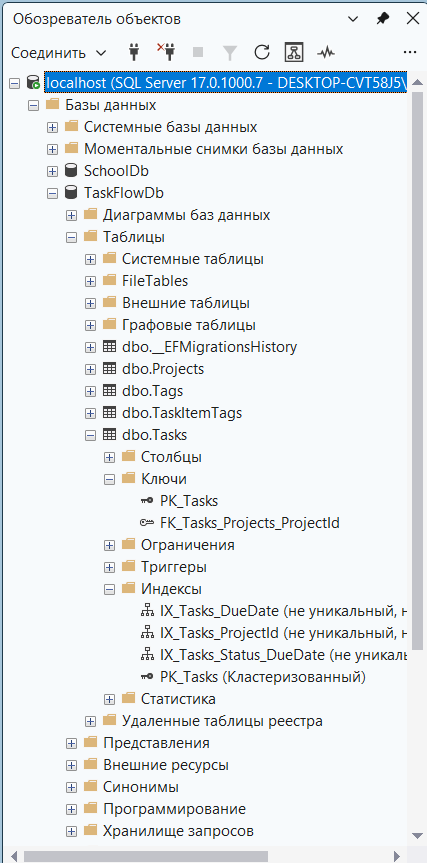
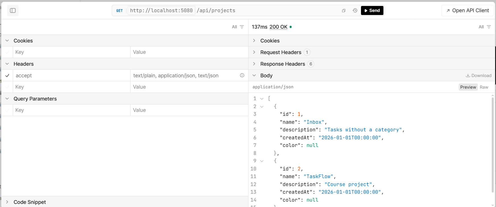
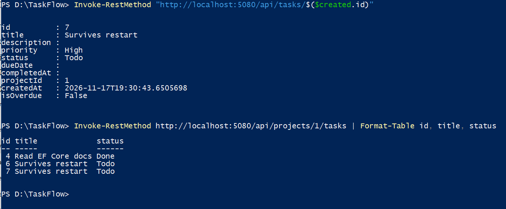

# Неделя 05: отчёт
## Что сделано

### Лабораторная
- Шаг 1: проверил сборку после недели 04, установил `dotnet-ef` 10.0, проверил подключение к SQL Server (у меня SQL Server 2025, всё работает так же).
- Шаг 2: создал проект `TaskFlow.Infrastructure` с пакетом `Microsoft.EntityFrameworkCore.SqlServer`, подключил его к Api, добавил в Api пакет `Microsoft.EntityFrameworkCore.Design`.
- Шаг 3: в `TaskItem` добавил навигацию `Tags` (многие-ко-многим), в `Project` константу `DescriptionMaxLength`. Domain по-прежнему не знает про EF Core.
- Шаг 4: `TaskFlowDbContext` с тремя `DbSet` и `ApplyConfigurationsFromAssembly`.
- Шаг 5: Fluent-конфигурации `TaskItemConfiguration`, `ProjectConfiguration`, `TagConfiguration` и `SeedConstants`: длины строк, `IsRequired`, уникальные индексы `Projects.Name` и `Tags.Name`, enum хранится строкой, таблица `Tasks`, связь `TaskItemTags (TaskItemId, TagId)`, `OnDelete(SetNull)` для проекта, стартовые проекты и метки через `HasData` с константной датой.
- Шаг 6: строка подключения в `dotnet user-secrets`, `AddDbContext` в `Program.cs`, логи SQL (`Microsoft.EntityFrameworkCore.Database.Command`) на уровне Information только в `appsettings.Development.json`, в `appsettings.json` Warning.
- Шаг 7: миграция `InitialCreate`, база `TaskFlowDb` (5 таблиц, 2 проекта, 3 метки), скрипт `database/ef-migrations.sql` с `--idempotent`.
- Шаг 8: `EfTaskRepository` и `EfProjectRepository`: чтение через `AsNoTracking`, загрузка для изменения с отслеживанием, `CancellationToken` в каждом вызове EF.
- Шаг 9: в `Program.cs` заменил `InMemoryTaskRepository` и `InMemoryProjectRepository` на EF-версии с `AddScoped`. Контроллеры и сервисы не менялись.
- Шаг 10: `ProjectsController` недели 3 работает поверх базы без изменений, дубликат `inbox` даёт 409, сравнение без учёта регистра теперь делает collation SQL Server.
- Шаг 11: `DbSeeder` создаёт 5 демонстрационных задач только в Development и только если таблица пустая (повторный запуск не дублирует данные).
- Шаг 12: свойство `Project.Color`, миграция `AddProjectColor` (`nvarchar(7)`), цвет в `ProjectDto`, `CreateProjectRequest` и маппинге. Создал и удалил пустую миграцию `Oops`, проверил, что уже применённую миграцию `remove` удалить не даёт.
- Шаг 13: запросы в `TaskFlow.Api.http`, проверка всех эндпоинтов и сохранения данных после перезапуска API (скриншот `restart-check.png`).

### Домашнее задание
1. **Фильтрация в базе.** В `ITaskRepository` добавлен `SearchAsync(TaskFilter filter, CancellationToken ct)`.
   - В `EfTaskRepository` запрос собирается из `IQueryable`: каждый `Where` добавляется, только если параметр задан, поиск идёт по `Title` и `Description` через `Contains`, сортировка по Id, `ToListAsync` вызывается один раз в конце.
   - В `InMemoryTaskRepository` то же через LINQ to Objects, `JsonFileTaskRepository` передаёт вызов во внутренний `_inner`.
   - `TaskService.GetAllAsync` теперь просто вызывает `SearchAsync`, контроллеры не менялись.
2. **Подтверждение фильтрации в SQL.** Для `GET /api/tasks?status=Todo&priority=High&search=fix` EF выполнил один `SELECT` с тремя условиями в `WHERE` (SQL ниже).
3. **Метки в базе.** `EfTagRepository` в Infrastructure зарегистрирован как Scoped вместо `InMemoryTagRepository`. В `ITagRepository` добавлены:
   - `GetSummariesAsync`: список `TagSummary(Id, Name, TaskCount)` одним запросом, количество задач считается подзапросом `COUNT` в SQL;
   - `GetByIdsAsync`: метки по списку id (`WHERE Id IN (...)`), специально с отслеживанием, потому что эти метки потом добавляются к задаче;
   - `GetSummaryByIdAsync`: одна метка с количеством задач для `GET /api/tags/{id}`.

   В `InMemoryTagRepository` эти методы сделаны через `Tag.Tasks.Count`.
4. **Эндпоинты меток.** `TagDto(int Id, string Name, int TaskCount)`, `GET /api/tags` возвращает метки по имени с количеством задач, `GET /api/tags/{id}` и `POST /api/tags` работают поверх базы (201 + Location, 409 при дубликате).
5. **Привязка тегов к задаче.** `PUT /api/tasks/{id}/tags` с телом `SetTaskTagsRequest { TagIds }`.
   - Логика в `TaskTagService`: задача загружается через `GetByIdAsync` (с отслеживанием и `Include(t => t.Tags)`), лишние метки удаляются из коллекции, недостающие добавляются, затем один `SaveChangesAsync`.
   - Ответы: 204 при успехе, 404 если задачи нет, 400 ProblemDetails со списком отсутствующих id (`Tags not found: 998, 999.`).
   - Эндпоинт вынесен в отдельный `TaskTagsController`, чтобы не менять `TasksController`.
6. **Проверка проекта при создании задачи.** Проверка недели 3 работает поверх базы: `POST` и `PUT` задачи с несуществующим `projectId` дают 400 ValidationProblemDetails, а не 500 от `FK_Tasks_Projects_ProjectId`. Оба случая есть в `.http` (запросы 44 и 45).
7. **Статистика.** `GET /api/tasks/stats` (отдельный `TaskStatsController`) возвращает `TaskStatsDto`: всего задач, словари по статусам и приоритетам и число просроченных. Группировки выполняет база через `GroupBy`, «сейчас» берётся один раз из `TimeProvider` и уходит в SQL параметром `@now`. В ответе есть все значения enum, даже с нулём.
8. **N+1.** Временный контроллер с двумя эндпоинтами: «медленный» считал задачи каждого проекта отдельным запросом в цикле, «быстрый» одним запросом с проекцией `p.Tasks.Count`. Таблица ниже, временный код удалён.
9. **Третья миграция.** Составной индекс `IX_Tasks_Status_DueDate (Status, DueDate)` через Fluent API, миграция `AddTaskStatusDueDateIndex`, `database/ef-migrations.sql` обновлён. `IX_Tasks_Status` удалён, `IX_Tasks_DueDate` оставлен (обоснование ниже).
10. **Цвет проекта в PUT.** В `UpdateProjectRequest` добавлен `Color` с той же проверкой формата, `ProjectService.UpdateAsync` получил необязательный параметр `color`, поэтому тесты не пришлось менять.
11. **Качество.** Чтение через `AsNoTracking` (кроме загрузки для изменения), `CancellationToken` передаётся в каждый вызов EF, нет `.Result` и `.Wait()`, нет фильтрации после `ToListAsync`, пароля в репозитории нет. `dotnet build` без ошибок, `dotnet test` 32 из 32. База пересоздаётся с нуля через `database drop` и `database update`.
12. **Файл `.http`.** Для каждого нового эндпоинта есть успешный запрос и запрос на ошибку (запросы 38-47).

## SQL из логов

**Пункт 2. Фильтрация** (`GET /api/tasks?status=Todo&priority=High&search=fix`), один запрос:

```sql
SELECT [t].[Id], [t].[CompletedAt], [t].[CreatedAt], [t].[Description], [t].[DueDate], [t].[Priority], [t].[ProjectId], [t].[Status], [t].[Title], [s].[Id], [s].[CreatedAt], [s].[Name], [s].[TaskItemId], [s].[TagId]
FROM [Tasks] AS [t]
LEFT JOIN (
    SELECT [t1].[Id], [t1].[CreatedAt], [t1].[Name], [t0].[TaskItemId], [t0].[TagId]
    FROM [TaskItemTags] AS [t0]
    INNER JOIN [Tags] AS [t1] ON [t0].[TagId] = [t1].[Id]
) AS [s] ON [t].[Id] = [s].[TaskItemId]
WHERE [t].[Status] = @status AND [t].[Priority] = @priority AND ([t].[Title] LIKE @term_contains ESCAPE N'\' OR ([t].[Description] IS NOT NULL AND [t].[Description] LIKE @term_contains0 ESCAPE N'\'))
ORDER BY [t].[Id], [s].[TaskItemId], [s].[TagId]
```

Все три условия в одном `WHERE`, значения переданы параметрами. `LEFT JOIN` к меткам появился из-за `Include(t => t.Tags)`.

**Пункт 5. Замена меток** (`PUT /api/tasks/3/tags` с `[1, 2]`, у задачи были метки 1 и 3). Сначала EF загрузил задачу с метками и метки `WHERE [t].[Id] IN (@ids1, @ids2)`, затем один `SaveChangesAsync` отправил один пакет:

```sql
SET NOCOUNT ON;
DELETE FROM [TaskItemTags]
OUTPUT 1
WHERE [TagId] = @p0 AND [TaskItemId] = @p1;
INSERT INTO [TaskItemTags] ([TagId], [TaskItemId])
VALUES (@p2, @p3);
```

`DELETE` убрал связь с меткой urgent (3), `INSERT` добавил frontend (2). Связь с backend (1) не менялась, поэтому EF её не трогал.

**Пункт 7. Статистика.** Вывод `ToQueryString()` для группировки по статусу (временно выводился через `ILogger`, потом убран):

```sql
SELECT [t].[Status], COUNT(*) AS [Count]
FROM [Tasks] AS [t]
GROUP BY [t].[Status]
```

За один вызов `GET /api/tasks/stats` выполняется **4 SQL-команды**:
1. `SELECT COUNT(*) FROM [Tasks]`;
2. `SELECT [t].[Status], COUNT(*) ... GROUP BY [t].[Status]`;
3. `SELECT [t].[Priority], COUNT(*) ... GROUP BY [t].[Priority]`;
4. `SELECT COUNT(*) FROM [Tasks] WHERE [t].[DueDate] < @now AND [t].[Status] <> N'Done'`.

Ответ на seed-данных: `total 5`, по статусам Todo 3, InProgress 1, Done 1, по приоритетам Low 1, Medium 2, High 1, Critical 1, просроченных 2.

## N+1: до и после

Проектов в базе: 12.

| Вариант | SQL-команд за запрос | Время, первый вызов | Время, повторный вызов |
|---|---|---|---|
| До: цикл с `CountAsync` на каждый проект | 13 (1 + 12) | 212 мс | 8,7 мс |
| После: проекция `p.Tasks.Count` | 1 | 60 мс | 8,2 мс |

На локальной базе с 12 проектами разница во времени повторного вызова почти незаметна, потому что каждый запрос занимает меньше миллисекунды. Главное различие в числе обращений к серверу: оно растёт вместе с числом проектов, и при удалённой базе с задержкой сети 1000 проектов дали бы 1001 запрос. Нашёл проблему по логу: на один HTTP-запрос было 13 строк `Executed DbCommand` с одинаковым `SELECT COUNT(*)`.

## Индекс IX_Tasks_Status_DueDate

Составной индекс `(Status, DueDate)` подходит под запрос просроченных задач (`Status <> 'Done' AND DueDate < @now`) и под фильтр списка по статусу: сначала колонка с условием на статус, потом диапазон по сроку, как на неделе 4. Отдельный `IX_Tasks_Status` я удалил: составной индекс начинается со `Status`, поэтому любой поиск только по статусу может использовать его, и второй индекс был бы дублем, который только замедляет INSERT и UPDATE (как `IX_TimeEntries_TaskId` на неделе 4). `IX_Tasks_DueDate` я оставил: в составном индексе `DueDate` стоит второй колонкой, и запрос или сортировка только по сроку без статуса не может искать по нему, как телефонный справочник по фамилии не помогает найти человека только по имени.

## Затраченное время

| Часть | Часы |
|---|---|
| Теория | 6 |
| Лабораторная: шаги 1-2 (инструменты, проект Infrastructure) | 0,7 |
| Лабораторная: шаги 3-5 (сущности, DbContext, конфигурации) | 1,8 |
| Лабораторная: шаги 6-7 (user-secrets, первая миграция) | 1,1 |
| Лабораторная: шаги 8-10 (репозитории, замена в DI) | 1,7 |
| Лабораторная: шаги 11-14 (seeder, вторая миграция, проверка) | 1,6 |
| ДЗ: фильтрация в базе | 1,5 |
| ДЗ: метки в базе и эндпоинты меток | 2 |
| ДЗ: привязка тегов к задаче | 1,5 |
| ДЗ: статистика | 1,5 |
| ДЗ: N+1 | 1 |
| ДЗ: третья миграция | 0,5 |
| ДЗ: `.http`, проверки, скриншоты, отчёт | 2 |
| **Итого** | **23** |

## Проблемы и как я их решил
- **`.gitignore` скрыл папку `Data`.** Правило `data/` с недели 2 (для JSON-файла задач) действовало на любую папку с таким именем, и `src/TaskFlow.Infrastructure/Data/` с `TaskFlowDbContext.cs` и `DbSeeder.cs` не попала в коммит. Заменил правило на `/data/` (только папка в корне) и дополнил коммит.
- **Запросы `.http` после перехода на базу.** Запрос 2 создавал проект `TaskFlow`, а он теперь уже есть из `HasData`, поэтому получал 409, и все запросы с переменной `createProject` падали. Переименовал проект в запросах 2, 3 и 20, а метку в запросе 30 сменил с `urgent` на `release` по той же причине.

## Ответы на вопросы для самопроверки

**1. Какие три действия недели 4 (ручной T-SQL) EF Core выполняет за вас, а какие решения по-прежнему остаются за разработчиком?**

EF сам создаёт таблицы и ограничения из классов через миграции (вместо `CREATE TABLE`), сам пишет `INSERT`, `UPDATE`, `DELETE` при `SaveChangesAsync` и сам превращает строки результата в объекты. За мной остаётся, какие индексы нужны, сколько запросов уходит в базу (N+1), что загружать через `Include` или проекцию, где нужен `AsNoTracking` и какое поведение `ON DELETE` выбрать.

**2. Чем отличаются `--project` и `--startup-project` в командах dotnet ef? Что произойдёт, если в startup-проекте нет пакета Design?**

`--project` это проект, где лежат DbContext и папка `Migrations`, у нас Infrastructure. `--startup-project` это проект, который запускается, чтобы взять конфигурацию и строку подключения, у нас Api. Если в startup-проекте нет пакета `Microsoft.EntityFrameworkCore.Design`, `dotnet ef` откажется работать с ошибкой, что startup-проект не ссылается на Design.

**3. Почему конфигурация модели находится в Infrastructure (Fluent API), а не атрибутами в классах Domain?**

Домен не должен знать, как и где хранятся данные, зависимости направлены к домену (неделя 2). Если писать атрибуты в классах Domain, ему понадобилась бы ссылка на EF, и смена хранилища затронула бы домен. Плюс Fluent API умеет больше: составные индексы, `HasData`, имя связующей таблицы.

**4. Что хранит таблица `__EFMigrationsHistory` и файл `TaskFlowDbContextModelSnapshot.cs`? Что сломается, если удалить снимок?**

`__EFMigrationsHistory` хранит, какие миграции уже применены к этой базе. Снимок хранит текущую модель, с которой EF сравнивает классы при `migrations add`. Если удалить снимок, EF решит, что модели не было, и следующая миграция попытается создать все таблицы заново, а на существующей базе это упадёт.

**5. В каком случае можно выполнить `dotnet ef migrations remove`, а в каком нужно создавать новую миграцию?**

`remove` можно, если последняя миграция ещё не применена к базе, как было с `Oops`. Если миграция уже применена, особенно на общей базе, её не удаляют и не правят, а создают новую миграцию, которая исправляет изменения. Для применённой `AddProjectColor` команда `remove` отказалась работать.

**6. Почему в `HasData` нельзя использовать `DateTime.UtcNow`, а в seeder при старте можно?**

Значения `HasData` попадают прямо в код миграции и в снимок. С `DateTime.UtcNow` значение было бы разным при каждом сравнении, EF видел бы изменения модели и добавлял бы `UpdateData` в каждую новую миграцию. Seeder это обычный код при запуске, он ничего не записывает в миграции, поэтому там можно использовать любые значения.

**7. В какой момент запрос `db.Tasks.Where(t => t.Priority == TaskPriority.High)` отправляется в SQL Server? Приведите три метода, которые вызывают выполнение.**

Сам `Where` ничего не отправляет, он только строит `IQueryable`. SQL уходит в момент материализации, например при `ToListAsync`, `FirstOrDefaultAsync`, `CountAsync` (ещё `AnyAsync` или `foreach`). Поэтому в `SearchAsync` я добавляю `Where` по условиям и вызываю `ToListAsync` один раз в конце.

**8. Когда использовать `AsNoTracking`, а когда нет? Что вернёт `SaveChangesAsync`, если изменить объект, загруженный с `AsNoTracking`, и не вызвать `Update`?**

`AsNoTracking` для чтения (GET): так быстрее и меньше памяти. Без него, когда объект потом меняется и сохраняется, как в `GetByIdAsync` для замены меток. Если изменить объект, загруженный с `AsNoTracking`, и не вызвать `Update`, EF о нём не знает, `SaveChangesAsync` вернёт 0, и ничего не сохранится.

**9. Опишите проблему N+1 на примере проектов и задач и два способа её исправить. Как её обнаружить по логам?**

Это когда сначала одним запросом загружаются проекты, а потом в цикле для каждого проекта делается ещё один запрос за его задачами: 1 + N запросов. Исправить можно проекцией через навигацию (`Select(p => new { p.Name, Count = p.Tasks.Count })`, один SQL с подзапросом) или через `Include`, чтобы загрузить всё одним запросом с JOIN. По логам видно много одинаковых `Executed DbCommand` на один HTTP-запрос, у меня было 13 вместо 1.

**10. Почему DbContext регистрируется как Scoped? Что будет, если зарегистрировать `EfTaskRepository` как Singleton?**

DbContext не потокобезопасен и накапливает загруженные объекты в Change Tracker, поэтому он должен жить один HTTP-запрос. Если сделать `EfTaskRepository` Singleton, он захватит один DbContext навсегда (captive dependency): в Development приложение упадёт при старте с `Cannot consume scoped service`, а без проверки под нагрузкой будут ошибки `A second operation was started on this context` и устаревшие данные.

**11. Где хранятся значения `dotnet user-secrets` и почему они не попадают в Git? Как то же значение передать в Docker?**

Они хранятся в профиле пользователя, `%APPDATA%\Microsoft\UserSecrets\<id>\secrets.json`, вне папки репозитория, поэтому Git их не видит. В `.csproj` лежит только `UserSecretsId`, это не секрет. В Docker то же значение передаётся переменной окружения `ConnectionStrings__DefaultConnection`.

**12. Что такое оптимистичная блокировка и какое исключение EF бросает при конфликте?**

Это когда строку не блокируют на время редактирования, а при сохранении проверяют, что её никто не изменил: в таблице есть колонка-версия (`rowversion`), и `UPDATE` содержит условие на старую версию. Если строку уже изменили, обновится 0 строк, и EF бросит `DbUpdateConcurrencyException`, которую API превращает в 409 Conflict.

## Скриншоты
- `ssms-tables.png`: база `TaskFlowDb` в SSMS, 5 таблиц, у `dbo.Tasks` ключ `FK_Tasks_Projects_ProjectId` и индексы `IX_Tasks_DueDate`, `IX_Tasks_ProjectId`, `IX_Tasks_Status_DueDate`.



- `scalar-projects.png`: Scalar с ответом `GET /api/projects`, проекты Inbox и TaskFlow из `HasData`.



- `restart-check.png`: задача `Survives restart` возвращается после перезапуска API и есть в задачах проекта Inbox.


