# Неделя 06: отчёт
## Что сделано

### Лабораторная
- Шаг 1: проверил, что рабочее дерево чистое, тег `week-05` на месте, решение собирается.
- Шаг 2: перевёл `TaskDto` и `ProjectDto` с позиционных записей на свойства `init`, чтобы фейковый клиент мог создавать их через инициализатор и копировать через `with`. Поправил `ToDto` в `TaskMappings` и `ProjectMappings`, API собирается как раньше, JSON не изменился.
- Шаг 3: создал проект `TaskFlow.Web` (шаблон `blazorwasm`), добавил его в решение и сослался только на `TaskFlow.Shared`. Перечисления домена приходят транзитивно через Shared.
- Шаг 4: закрепил порт 5090 в `launchSettings.json`, прошёл экскурсию по шаблону (ответы ниже).
- Шаг 5: удалил `Counter`, `Weather` и `sample-data`, создал папки `Components`, `Models`, `Services`, `Pages/Tasks`, `Pages/Projects`, общие `@using` в `_Imports.razor`, `wwwroot/appsettings.json` только с `ApiBaseUrl`.
- Шаг 6: `ITaskApiClient` и `FakeTaskApiClient` (данные в памяти, задержка 400 мс через `Task.Delay`, `CancellationToken` во всех методах), регистрация одной строкой `AddSingleton<ITaskApiClient, FakeTaskApiClient>()`.
- Шаг 7: модели `TaskFormModel`, `ProjectFormModel` и `TaskDisplay`.
- Шаг 8: `PriorityBadge` с обязательным параметром и изолированными стилями, `StatusSelector` с парой `Value` / `ValueChanged` для `@bind-Value`.
- Шаг 9: `ConfirmButton` (`ChildContent` + `EventCallback`) и `TaskCard`. Проверил предупреждение RZ2012, когда убрал текст между тегами `ConfirmButton`.
- Шаг 10: страница `/tasks`: загрузка, фильтры через `@bind-Value:after` и `@bind:after`, живой поиск через `@bind:event="oninput"`, список с `@key`, удаление через `EventCallback`. Проверил опыт с `@key`: без него открытое подтверждение удаления переезжает на соседнюю карточку.
- Шаг 11: один компонент `TaskForm` с валидацией на страницах `/tasks/new` и `/tasks/{Id:int}/edit`, параметр строки запроса `projectId`, переход через `NavigationManager`.
- Шаг 12: страница деталей `/tasks/{Id:int}`, загрузка в `OnParametersSetAsync`, смена статуса через `StatusSelector`, удаление с переходом на список.
- Шаг 13: страница `/projects` с таблицей, формой нового проекта и сообщением о дубликате имени.
- Шаг 14: меню с `NavLink` (Home, Tasks, New task, Projects) и главная страница со сводкой.
- Шаг 15: лог в Console, атрибут `b-...` в Elements, файл `TaskFlow.Web.styles.css` в Network, искусственное исключение с жёлтой полосой и точка останова в Visual Studio.

### Ответы на вопросы экскурсии (шаг 4)
- **Почему счётчик обновляется без `StateHasChanged`?** `IncrementCount` вызывается из `@onclick`. После обработчика события DOM Blazor сам перерисовывает компонент, поэтому новое значение `currentCount` сразу видно.
- **Что грузится из `_framework/`?** После F5 во вкладке Network видна загрузка `dotnet.js`, `dotnet.native.wasm` и `.dll`, среди них `TaskFlow.Web` и `TaskFlow.Shared`. Это рантайм .NET и сборки приложения, которые выполняются прямо в браузере.
- **`index.html`:**
  - `
`: место, куда монтируется компонент `App`;
  - `
`: жёлтая полоса при необработанном исключении;
  - ссылка на `TaskFlow.Web.styles.css`: все изолированные стили компонентов в одном файле;
  - `<base href="/" />`: база для ссылок без начального `/`.
- **`Program.cs` и `App.razor`.** `RootComponents.Add<App>("#app")` рендерит `App` внутрь `
`. В `App.razor` компонент `Router` находит страницы с `@page`, а `RouteView` с `DefaultLayout="typeof(MainLayout)"` выводит найденную страницу внутри макета.
- **`MainLayout.razor`.** `@Body` это место, куда подставляется текущая страница. Меню слева общее для всех страниц.
- **Атрибут `b-...`.** У элементов макета и меню есть атрибут вида `b-vk9yad5y1p`, а селекторы из `MainLayout.razor.css` переписаны в вид `.top-row[b-vk9yad5y1p]`. Так стиль действует только на свой компонент.

### Активный пункт меню (шаг 14)
У пункта Tasks режим `NavLinkMatch.Prefix`, поэтому он подсвечен на `/tasks`, `/tasks/5` и `/tasks/5/edit`. Это удобно: на любой странице задачи видно, в каком разделе ты находишься. Минус в том, что на `/tasks/new` подсвечены сразу два пункта, Tasks и New task. Я оставил так: другой вариант (`NavLinkMatch.All` у Tasks) убрал бы подсветку на деталях и редактировании задачи, а это встречается чаще, чем страница создания.

### Домашнее задание
1. **Фильтры в адресе.** На `/tasks` статус, приоритет и поиск читаются из строки запроса через `[SupplyParameterFromQuery]` и записываются через `NavigationManager.GetUriWithQueryParameters` и `NavigateTo`. Загрузка перенесена в `OnParametersSetAsync`, потому что при смене адреса экземпляр страницы переиспользуется. Поиск фильтрует карточки на каждую букву локально, а в адрес попадает при уходе с поля (`@onblur`), чтобы не создавать запись истории на каждый символ. F5 и кнопка «Назад» восстанавливают фильтры.
2. **Страница проекта `/projects/{Id:int}`.** В `ITaskApiClient` добавлен `GetProjectAsync`, в фейке он реализован. На странице название, описание, счётчик «Open tasks: N of M», задачи проекта через существующий `TaskCard` (загрузка через `GetTasksAsync(projectId: Id)`), кнопка Add task на `/tasks/new?projectId={Id}` и сообщение «not found» для несуществующего проекта. На `/projects` название проекта стало ссылкой.
3. **Быстрая смена статуса в карточке.** `TaskCard` показывает Start, Complete или Reopen по статусу и поднимает событие `EventCallback<StatusChangeRequest>`, сама API не вызывает. Кнопка видна, только если родитель подписался (`HasDelegate`). Общий код родителей вынесен в метод расширения `ApplyStatusChangeAsync` в `TaskApiClientExtensions`: он меняет статус, получает обновлённую задачу и заменяет её в списке. Благодаря `@key` перерисовывается только одна карточка.
4. **`LoadingIndicator` и `EmptyState`.** `LoadingIndicator` со спиннером Bootstrap и параметром `Text` (по умолчанию «Loading...»), `EmptyState` с обязательным `ChildContent`. Ими заменены все `
<em>Loading...</em>
` и сообщения о пустом списке на 7 страницах, поиск `<em>Loading` ничего не находит.
5. **Правило Critical в форме.** `TaskFormModel` реализует `IValidatableObject`: при приоритете Critical описание без пробелов по краям должно быть не короче 10 символов. Ошибка привязана к полю `Description` и выводится под ним. Форма одна, поэтому правило работает и при создании, и при редактировании.
6. **Защита от гонки.** В `TaskList` перед каждой загрузкой предыдущая отменяется через `CancellationTokenSource`, токен передаётся в `GetTasksAsync`. `OperationCanceledException` ловится и не даёт жёлтой полосы. Страница реализует `IDisposable` и отменяет загрузку при уходе с неё. При быстром переключении фильтра список соответствует последнему выбору.
7. **Изоляция стилей.** У новых компонентов и страниц свои `.razor.css` (`LoadingIndicator`, `EmptyState`, `ProjectDetails`), атрибутов `style="..."` в `.razor` нет.
8. **Качество.** `dotnet build` без ошибок и без RZ2012, `dotnet test` 32 из 32, `StateHasChanged` в коде нет, `@key` стоит во всех циклах по данным (списки задач, строки проектов, проекты в форме).

## Затраченное время

| Часть | Часы |
|---|---|
| Теория | 6 |
| Лабораторная: шаги 1-5 (подготовка, шаблон, экскурсия) | 1,6 |
| Лабораторная: шаги 6-9 (сервис, модели, компоненты) | 2,2 |
| Лабораторная: шаги 10-14 (страницы и меню) | 2,8 |
| Лабораторная: шаги 15-16 (отладка, скриншоты) | 0,5 |
| ДЗ: фильтры в адресе | 1,5 |
| ДЗ: страница проекта | 1,5 |
| ДЗ: быстрая смена статуса | 1,5 |
| ДЗ: `LoadingIndicator` и `EmptyState` | 1 |
| ДЗ: правило Critical | 1 |
| ДЗ: защита от гонки | 1 |
| ДЗ: изоляция стилей и качество | 1 |
| Отчёт и скриншоты | 1,5 |
| **Итого** | **23,1** |

## Проблемы и как я их решил
- **Приложение висело на «Loading».** После запуска шаблона кружок загрузки не исчезал, а в Console была ошибка 404 для `_framework/blazor.webassembly#[.{fingerprint}].js`. В `index.html` .NET 10 скрипт записан с заготовкой `#[.{fingerprint}]`, которую при сборке заменяет настройка `OverrideHtmlAssetPlaceholders`. Я заменил `TaskFlow.Web.csproj` на вариант из задания, где её нет, поэтому заготовка осталась в адресе. Вернул в `PropertyGroup` строку `<OverrideHtmlAssetPlaceholders>true</OverrideHtmlAssetPlaceholders>`.
- **Стили карточек не применялись.** Файлы стилей `TaskCard`, `TaskList` и `TaskDetails` получили расширение `.razor.razor` вместо `.razor.css`, и Blazor не считал их изолированными стилями: карточки шли столбиком без рамок. Переименовал их через `git mv`. После переименования сборка упала с BLAZOR101 («больше одного scoped css файла»), потому что старые файлы ещё оставались. Убрал лишние, и стили применились.

## Ответы на вопросы для самопроверки

**1. Где выполняется код C# компонента в Blazor WebAssembly Standalone и в Blazor Web App с Interactive Server? Что из этого следует для доступа к базе данных?**

В WebAssembly Standalone код выполняется в браузере пользователя, .NET скачивается туда вместе со сборками. В Interactive Server код выполняется на сервере, а изменения DOM уходят в браузер через SignalR. Поэтому из WebAssembly доступа к базе нет вообще, всё идёт через HTTP API, а в Interactive Server компонент может обращаться к базе напрямую.

**2. Какие три аргумента приведены в пользу WebAssembly Standalone для этого курса?**

Явная граница клиент/сервер: клиент не видит базу, и мы по-настоящему проектируем API, CORS и токены. Модель как у SPA на React или Vue: приложение грузится один раз и ходит в API за JSON. Простое развёртывание: результат публикации это папка статических файлов, которую раздаёт nginx. Ещё работают все инструменты браузера.

**3. За что отвечает каждый из файлов: `Program.cs`, `App.razor`, `MainLayout.razor`, `wwwroot/index.html`, `_Imports.razor`?**

- `Program.cs`: точка входа, настройка DI и корневых компонентов.
- `App.razor`: маршрутизатор, который находит страницы по `@page`.
- `MainLayout.razor`: общий макет с меню, текущая страница выводится через `@Body`.
- `wwwroot/index.html`: единственная HTML-страница, приложение монтируется в `
`.
- `_Imports.razor`: общие `@using` для всех компонентов.

**4. Чем `[EditorRequired]` отличается от проверки на null во время выполнения?**

`[EditorRequired]` это проверка на этапе компиляции: если родитель не передал параметр, компилятор выдаёт предупреждение RZ2012. Во время выполнения он ничего не проверяет, параметр может прийти пустым. Проверка на null работает уже во время выполнения программы.

**5. Почему компонент не должен присваивать значение своему параметру? Как правильно сообщить об изменении?**

Параметры перезаписываются родителем при каждой его перерисовке, поэтому значение, которое компонент присвоил сам, «откатится». Правильно сообщить родителю через `EventCallback` (например, `ValueChanged.InvokeAsync(newValue)`), а родитель уже сам изменит своё поле. Так сделан `StatusSelector`.

**6. Какие два параметра нужны компоненту, чтобы родитель мог написать `@bind-Value`?**

`Value` и `ValueChanged` типа `EventCallback<T>`. Компилятор превращает `@bind-Value="field"` в `Value="field"` и `ValueChanged="v => field = v"`.

**7. Чем отличаются `@bind`, `@bind:event="oninput"` и `@bind:after`?**

`@bind` связывает поле и элемент в обе стороны и обновляет поле по событию change, то есть при уходе с поля или Enter. `@bind:event="oninput"` обновляет поле на каждый введённый символ, это для живого поиска. `@bind:after` вызывает метод после того, как значение записано в поле, например загрузку данных при смене фильтра.

**8. Что произойдёт со списком карточек без `@key` после удаления первого элемента?**

Blazor сравнивает элементы по позиции и решит, что у всех карточек изменились параметры, а исчезла последняя. Внутреннее состояние карточек «переедет» к соседям: например, открытое подтверждение удаления окажется у другой задачи. Я это проверил на шаге 10.

**9. Почему детали задачи загружаются в `OnParametersSetAsync`, а список задач в `OnInitializedAsync`?**

При переходе с `/tasks/1` на `/tasks/2` Blazor не создаёт страницу заново, а только передаёт новый `Id`, поэтому `OnInitializedAsync` второй раз не вызовется, а `OnParametersSetAsync` вызовется. У списка задач параметров маршрута нет, ему хватает одной загрузки при создании. В домашке список тоже переехал в `OnParametersSetAsync`, потому что фильтры теперь в строке запроса.

**10. Назовите два случая, когда `StateHasChanged` не нужен, и один, когда он обязателен.**

Не нужен после обработчика события DOM (`@onclick`, `@bind`) и после вызова `EventCallback`: Blazor перерисует сам. Обязателен, когда состояние меняется снаружи Blazor, например в callback таймера `System.Threading.Timer`, и тогда вызывается через `InvokeAsync(StateHasChanged)`.

**11. Зачем валидировать данные на клиенте, если сервер всё равно их проверяет? И наоборот?**

Клиентская проверка нужна для удобства: пользователь сразу видит ошибку под полем, без запроса к серверу. Серверная нужна для защиты: кто угодно может отправить запрос к API в обход формы, поэтому полагаться только на клиент нельзя.

**12. Как изоляция CSS превращает селектор `.priority-badge`, и почему этот стиль не действует на дочерний компонент?**

Blazor добавляет всем элементам компонента атрибут вида `b-xxxxxxxxxx` и переписывает селектор в `.priority-badge[b-xxxxxxxxxx]`. У элементов дочернего компонента свой атрибут, поэтому селектор родителя к ним не подходит. Чтобы стилизовать дочерний компонент, нужен `::deep`, как `.task-grid ::deep .task-card` в `TaskList.razor.css`.

## Скриншоты
- `tasks-list.png`: страница `/tasks` с карточками задач сеткой, просроченные отмечены.

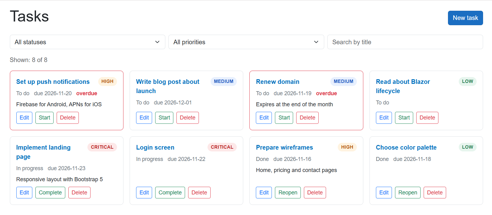

- `task-form-validation.png`: форма новой задачи с ошибкой «Title is required.».

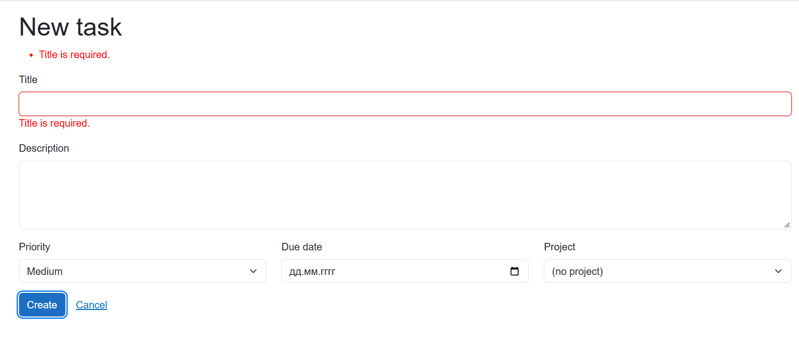

- `task-details.png`: страница деталей задачи `/tasks/5`.

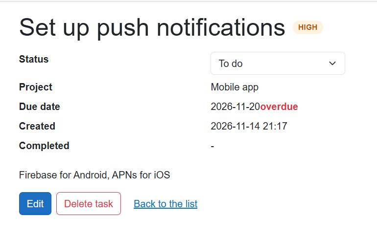

- `projects.png`: страница `/projects` с таблицей проектов и формой нового проекта.

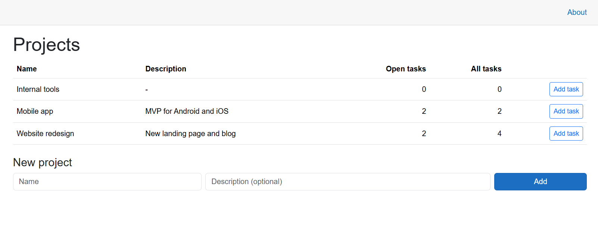

- `devtools-console.png`: лог `Loaded ... tasks` в Console после смены фильтра.

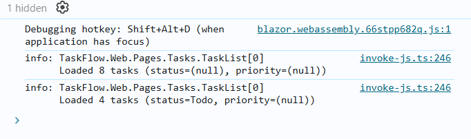

- `devtools-elements.png`: атрибут изоляции `b-...` у элементов и переписанный селектор в Styles.

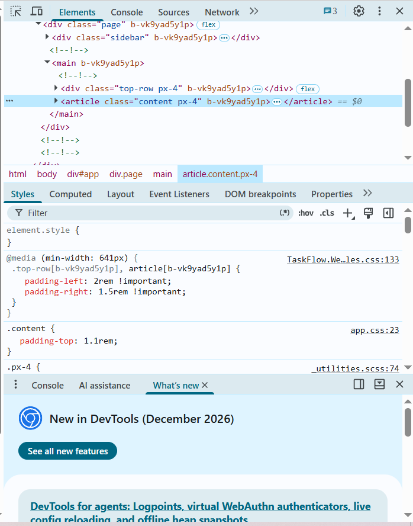

- `breakpoint.png`: остановка на точке останова в `TaskList.DeleteAsync` в Visual Studio.

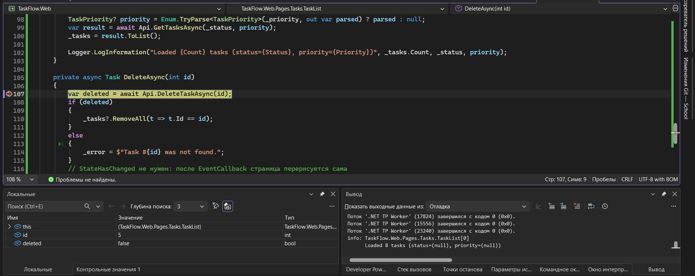

- `filters-in-url.png`: фильтры In progress и Critical в адресной строке.

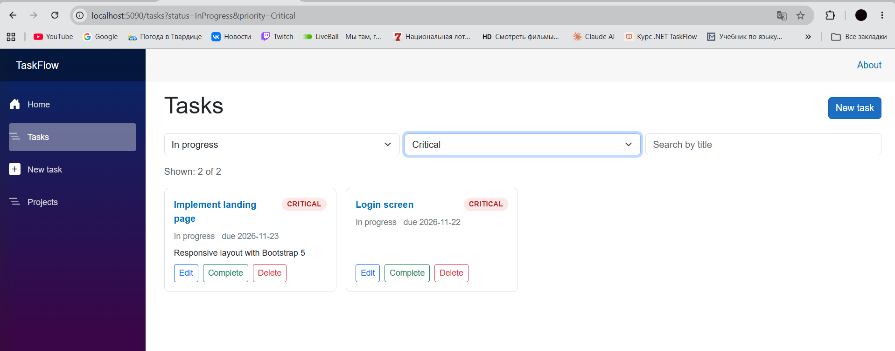

- `project-details.png`: страница проекта Mobile app с задачами и кнопкой Add task.

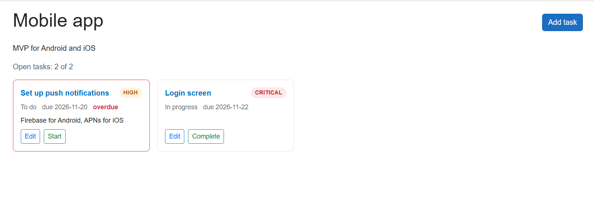

- `quick-status.png`: задача Renew domain после Start, у неё статус In progress и кнопка Complete.

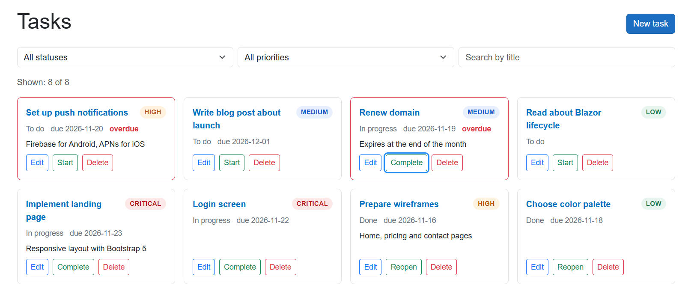

- `critical-validation.png`: ошибка правила Critical под полем Description.

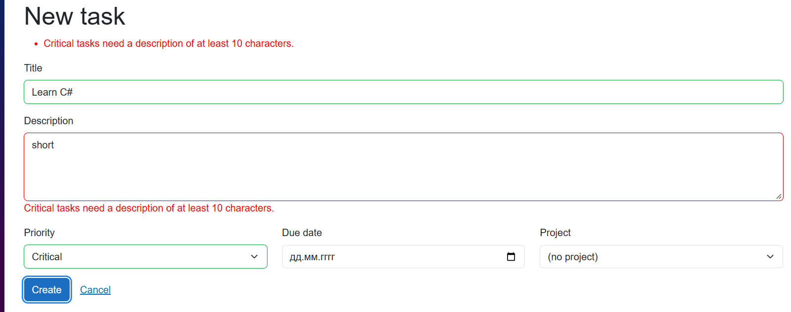
