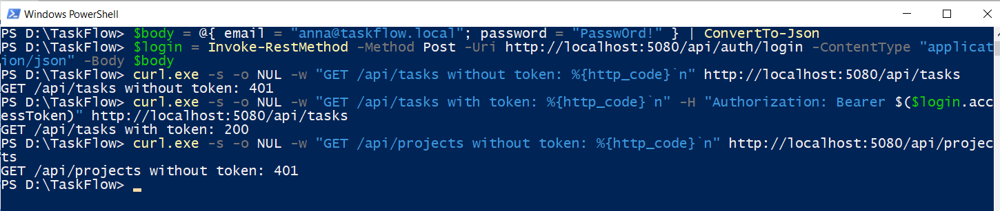
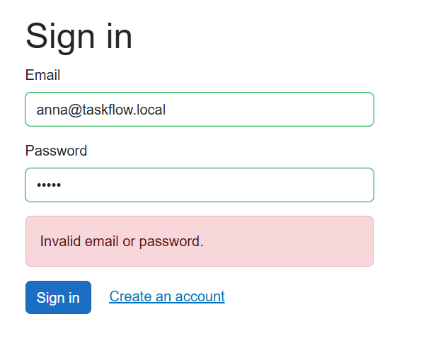
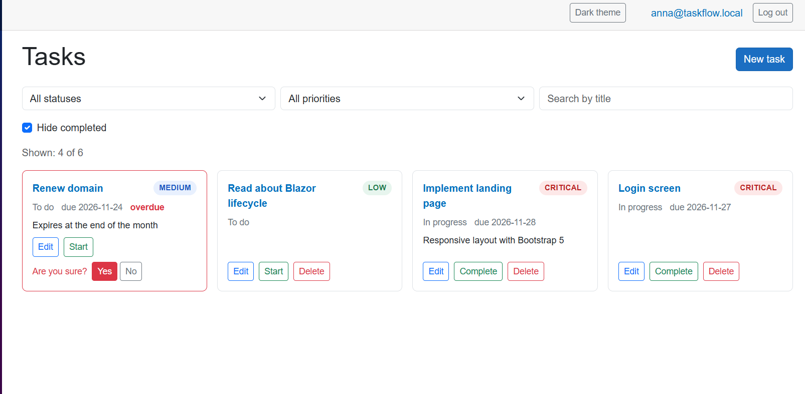
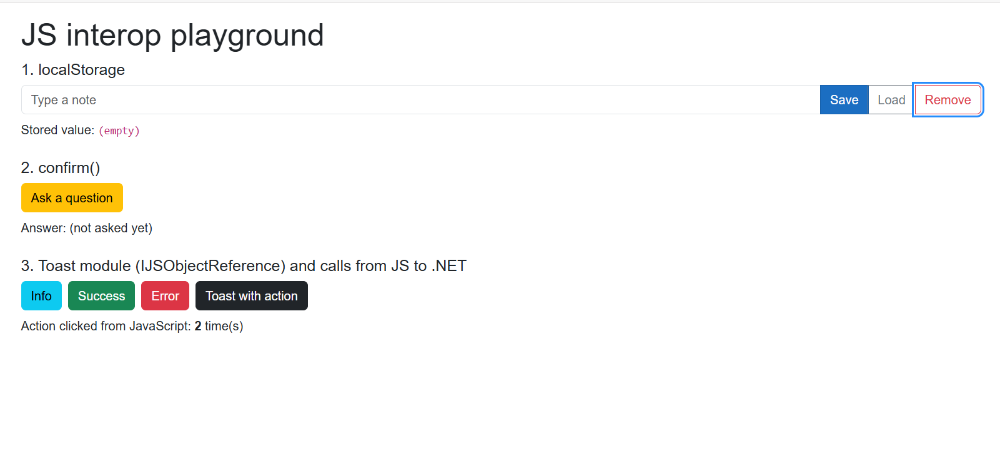
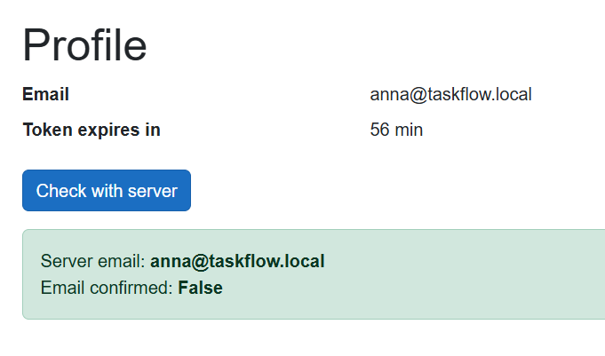
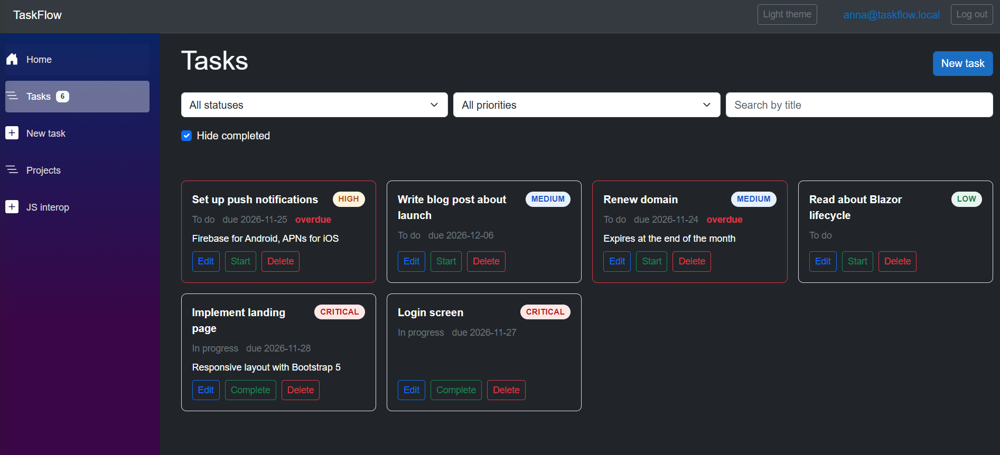
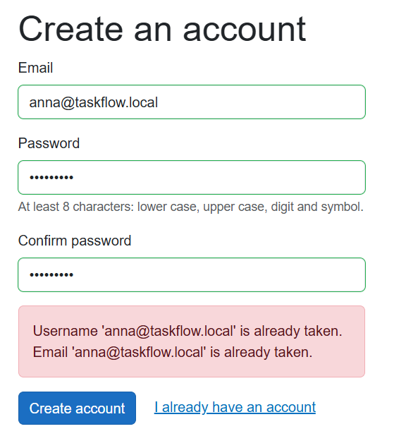

# Неделя 07: отчёт
## Что сделано

### Лабораторная
- Шаг 0: проверил, что рабочее дерево чистое, тег `week-06` на месте, решение собирается и тесты проходят.
- Шаг 1: добавил пакет `Microsoft.AspNetCore.Identity.EntityFrameworkCore`, класс `AppUser : IdentityUser` в `Infrastructure/Identity`. `TaskFlowDbContext` теперь наследуется от `IdentityDbContext<AppUser>`, первой строкой `OnModelCreating` стоит `base.OnModelCreating(modelBuilder)`.
- Шаг 2: в `Program.cs` API добавил `AddAuthorization`, `AddIdentityApiEndpoints<AppUser>().AddEntityFrameworkStores<TaskFlowDbContext>()` и временную политику CORS `WebClient` для `http://localhost:5090`. Конвейер: `UseCors` → `UseAuthentication` → `UseAuthorization` → `MapControllers` → `MapGroup("/api/auth").MapIdentityApi<AppUser>()`. На `TasksController` и `ProjectsController` стоит `[Authorize]`.
- Шаг 3: миграция `AddIdentity` (только таблицы `AspNet*`), свойство `OwnerId` и метод `AssignOwner` в `TaskItem`, в `TaskItemConfiguration` столбец `nvarchar(450)`, индекс и внешний ключ на `AppUser` с `SetNull`. В `Create` владелец берётся из claim `NameIdentifier`, задача создаётся через `request.ToEntity()`, получает владельца и только потом сохраняется. Миграция `AddTaskOwnerId`, обе применены, в базе 7 таблиц `AspNet*`.
- Шаг 4: файл `auth.http` с регистрацией, слабым паролем, входом, запросами без токена и с токеном, `manage/info`. Проверил в PowerShell: без токена 401, с токеном 200, пароли в `AspNetUsers` лежат хэшем.
- Шаг 5: `ApiBaseUrl` со слэшем на конце, `LocalStorageService` (значения как JSON, испорченное значение удаляется) и `BrowserDialogService` (`confirm`, `alert`).
- Шаг 6: модуль `wwwroot/js/toast.js` (`showToast`, `clearToasts`, текст через `textContent`), стили уведомлений, `ToastService` с загрузкой модуля через `IJSObjectReference`, двумя методами `[JSInvokable]` и `DisposeAsync`.
- Шаг 7: `AppState` с закрытыми сеттерами, событием `OnChange`, флагом `HideCompleted` в localStorage и счётчиком открытых задач в памяти.
- Шаг 8: пакет `Microsoft.AspNetCore.Components.Authorization`, папка `Auth` (модели, модели форм, `SafeReturnUrl`, `TokenAuthStateProvider`, `AuthService`), регистрации в `Program.cs` клиента. `AuthService` получает отдельный `HttpClient` с адресом API.
- Шаг 9: `AuthorizeRouteView` в `App.razor`, `RedirectToLogin` с `returnUrl`, `@attribute [Authorize]` на всех страницах задач и проектов.
- Шаг 10: страницы `Login` и `Register` с клиентской валидацией и ошибками сервера под формой.
- Шаг 11: `UserMenu` в шапке, `MainLayout` инициализирует `AppState`, `NavMenu` показывает Tasks, New task и Projects только вошедшему, у Tasks счётчик открытых задач, `Home` берёт имя из каскадного `Task<AuthenticationState>`.
- Шаг 12: на странице задач флажок «Hide completed», который переживает F5, счётчик в меню и уведомление после удаления. В `TaskList` из недели 6 уже был `IDisposable` для отмены загрузки, поэтому отписку от `AppState` добавил в тот же `Dispose`.
- Шаг 13: песочница `/interop`: localStorage, `confirm()`, три вида уведомлений и уведомление с кнопкой, которая вызывает .NET из JavaScript.
- Шаг 14: коммит лабораторной.

### Домашнее задание
1. **Политика паролей на сервере.** `AddIdentityApiEndpoints<AppUser>(options => ...)` с `RequiredLength = 8`, `RequireNonAlphanumeric = true` и `User.RequireUniqueEmail = true`. Регистрация с `Pass0r!` возвращает 400, с `Passw0r!` проходит. Повтор email выдаёт сразу две ошибки: имя занято и email занят.
2. **Те же правила на клиенте.** В `RegisterModel` `MinLength(8)` и регулярное выражение на строчную, заглавную букву, цифру и символ, подсказка под полем обновлена. Короткий пароль ловится до запроса, ошибки сервера по-прежнему показываются под формой.
3. **Страница профиля `/profile`.** Email из каскадного `Task<AuthenticationState>`, минуты до истечения из `AuthSession.ExpiresAt` через `TokenAuthStateProvider.GetSessionAsync()`. Кнопка «Check with server» вызывает `AuthService.GetProfileAsync`: он сам собирает `HttpRequestMessage` на `api/auth/manage/info` и кладёт заголовок `Authorization: Bearer <accessToken>`. Ответ читается в запись `ProfileInfo`. При 401 страница выполняет выход, показывает уведомление «Session expired» и переходит на `/login?returnUrl=profile`. Ссылка на профиль это email в `UserMenu`.
4. **Тема через каскадное значение.** `ThemeState` хранит `ThemeInfo(Name)`, сохраняет её в localStorage под ключом `taskflow.theme` и при старте загружает. На `<body>` тема ставится через модуль `wwwroot/js/theme.js` с функцией `applyTheme(name)`, ссылку на модуль держит `ThemeState`, он реализует `IAsyncDisposable`. `MainLayout` подписан на `ThemeState.OnChange` и оборачивает `@Body` в `<CascadingValue Value="Theme.Current">`. Получатели через `[CascadingParameter]`: `Home` (серый блок) и `TaskCard` (тёмная карточка). Переключатель `ThemeToggle` в шапке. При смене темы создаётся новый объект `ThemeInfo`, иначе получатели не перерисуются. После F5 тема сохраняется.
5. **Уведомления и подтверждения.** Создание и редактирование задачи показывают уведомление Success, исключение от `ITaskApiClient` показывает Error. В `TaskForm` добавлен `OnInvalidSubmit`, ошибка валидации тоже даёт уведомление Error. Форма работает через свой `EditContext`, и кнопка «Cancel» при `IsModified()` спрашивает подтверждение через `BrowserDialogService.ConfirmAsync`.
6. **Отписка проверена.** Подписчиков три (`TaskList`, `NavMenu`, `MainLayout`), у каждого есть пара `-=` в `Dispose`. Эксперимент описан ниже.
7. **Сервер не доверяет клиенту.** Вывод команд и объяснение ниже.
8. **Качество кода.** В итоговой версии нет `Console.WriteLine` и закомментированного кода, секретов в репозитории нет, строка подключения в user-secrets.

### Эксперимент с отпиской
Временно убрал `AppState.OnChange -= HandleStateChanged` в `Dispose` страницы задач и добавил в обработчик `Console.WriteLine("Tasks page handler")`. Переходил между Tasks и Home через меню и закончил на Tasks, потом очистил консоль и один раз кликнул «Hide completed». В консоли появилось 3 строки (`(3) Tasks page handler`), по числу открытий страницы Tasks.

Каждый переход на `/tasks` создаёт новый экземпляр `TaskList`, и он подписывается на `OnChange`. При уходе Blazor вызывает `Dispose`, но без `-=` событие продолжает держать ссылку на старый экземпляр. `AppState` в WebAssembly живёт всю жизнь вкладки, поэтому старые страницы не собираются сборщиком мусора, и одно изменение вызывает обработчик у живой страницы и у двух уже закрытых. Это утечка памяти и лишняя работа. Потом вернул отписку и убрал `Console.WriteLine`.

### Сервер не доверяет клиенту
```text
PS D:\TaskFlow> curl.exe -s -o NUL -w "GET /api/tasks without token: %{http_code}`n" http://localhost:5080/api/tasks
GET /api/tasks without token: 401
PS D:\TaskFlow> curl.exe -s -o NUL -w "GET /api/tasks with token: %{http_code}`n" -H "Authorization: Bearer $($login.accessToken)" http://localhost:5080/api/tasks
GET /api/tasks with token: 200
PS D:\TaskFlow> curl.exe -s -o NUL -w "GET /api/projects without token: %{http_code}`n" http://localhost:5080/api/projects
GET /api/projects without token: 401
```

`AuthorizeView` и `[Authorize]` на страницах Blazor работают в браузере пользователя и только решают, что показать в интерфейсе. Весь код WebAssembly скачивается в браузер, его можно посмотреть и изменить, а к API можно обратиться вообще без нашего клиента, например через curl. Поэтому скрытая кнопка или редирект на вход это удобство, а не защита. Данные защищает только сервер: `[Authorize]` на контроллерах и проверка токена в `UseAuthentication`, что и видно по 401 выше.

### Token storage
После входа в localStorage под ключом `taskflow.auth` лежит JSON с email, `accessToken`, `refreshToken` и `expiresAt`. localStorage доступен любому JavaScript, который выполняется на странице. Если на сайт попадёт чужой скрипт через XSS (например, через непроверенный вывод HTML или заражённую npm-библиотеку), он прочитает `localStorage.getItem("taskflow.auth")` и отправит токены на свой сервер. С `accessToken` злоумышленник ходит в API от имени пользователя, а `refreshToken` даёт ему продлевать доступ. Против этого в проекте уже есть несколько мер. Razor автоматически экранирует всё, что выводится через `@`, поэтому название задачи с `<script>` покажется текстом. В `toast.js` сообщение вставляется через `textContent`, а не `innerHTML`. Срок жизни `accessToken` 1 час, после этого клиент сам забывает сессию. Но если XSS всё-таки случился, эти меры токен не спасут. В варианте BFF (Backend for Frontend) токены хранит сервер, а браузер получает cookie с флагом `HttpOnly`, который JavaScript не видит вообще, поэтому украсть его скриптом нельзя. Для cookie ещё нужны `Secure` и `SameSite`, чтобы закрыть CSRF. Мы не используем BFF в учебном проекте, потому что это отдельное серверное приложение рядом с клиентом, свой прокси к API и защита от CSRF, а цель недели в том, чтобы увидеть, как работает токен и `AuthenticationStateProvider`. На учебных данных риск небольшой, а для продакшена правильным выбором был бы BFF.

## Затраченное время

| Часть | Часы |
|---|---|
| Теория | 6 |
| Лабораторная: часть A, сервер (шаги 0-4) | 2 |
| Лабораторная: часть B, состояние и JS interop (шаги 5-7) | 1,7 |
| Лабораторная: часть C, аутентификация на клиенте (шаги 8-11) | 2,3 |
| Лабораторная: часть D, интеграция и сдача (шаги 12-14) | 1,1 |
| ДЗ: политика паролей на сервере и клиенте | 1 |
| ДЗ: страница профиля | 2 |
| ДЗ: тема через каскадное значение | 2,5 |
| ДЗ: уведомления и подтверждение ухода | 1,5 |
| ДЗ: эксперимент с отпиской | 0,5 |
| ДЗ: проверка 401/200 и раздел Token storage | 1 |
| ДЗ: качество кода | 0,5 |
| Отчёт и скриншоты | 1 |
| **Итого** | **23,1** |

## Проблемы и как я их решил
- **`/api/projects` без токена отдавал 200.** Когда проверял команды для отчёта, задачи без токена давали 401, а проекты 200. На шаге 2.4 я поставил `[Authorize]` только на `TasksController`. Добавил `using Microsoft.AspNetCore.Authorization;` и атрибут на `ProjectsController`, перезапустил API, стало 401.
- **`UseAuthorization` стоял два раза.** В `Program.cs` API от шаблона осталась строка `app.UseAuthorization();` выше нового блока, то есть раньше `UseCors` и `UseAuthentication`, а `MapControllers` тоже вызывался дважды. Убрал лишние строки и оставил порядок `UseCors` → `UseAuthentication` → `UseAuthorization` → `MapControllers`.

## Ответы на вопросы для самопроверки

**1. Почему в Blazor WebAssembly Scoped-сервис ведёт себя как Singleton? Сколько экземпляров AppState будет при двух открытых вкладках?**

Scoped означает «один экземпляр на область». На сервере область это HTTP-запрос, а в WebAssembly всё приложение работает в одной вкладке, и область создаётся одна на всю её жизнь. При двух вкладках будет два экземпляра `AppState`, потому что каждая вкладка это отдельное приложение. Общий у них только localStorage.

**2. Чем каскадное значение отличается от сервиса-контейнера? Приведите по одному уместному примеру для каждого.**

Каскадное значение передаётся от компонента вниз по дереву, его получают все потомки через `[CascadingParameter]`, без DI и без подписки. Подходит для того, что читают многие и меняют редко, например тема или `Task<AuthenticationState>`. Сервис-контейнер лежит в DI, его может получить любой компонент, даже из другой ветки, и он сообщает об изменениях событием. Например `AppState` со счётчиком задач, который меняет страница задач, а показывает меню.

**3. Зачем компоненту, подписанному на AppState.OnChange, реализовывать IDisposable? Что будет без этого?**

Чтобы в `Dispose` отписаться через `-=`. Без этого событие держит ссылку на уже закрытый компонент, он не удаляется из памяти, и его обработчик продолжает вызываться. В моём эксперименте одно изменение дало 3 вызова вместо одного.

**4. Почему в обработчике OnChange вызывают InvokeAsync(StateHasChanged), а не просто ничего?**

Blazor сам перерисовывает компонент только после его собственных событий (клик, `@bind`) и методов жизненного цикла. Изменение в `AppState` пришло из другого компонента, поэтому без `StateHasChanged` меню не узнает, что надо перерисоваться. `InvokeAsync` выполняет вызов в контексте рендеринга компонента, а не в том месте, откуда пришло событие.

**5. В чём разница между InvokeAsync<T> и InvokeVoidAsync? Почему все вызовы JS interop асинхронные?**

`InvokeAsync<T>` вызывает JS-функцию и возвращает её результат типа `T`, например `bool` из `confirm`. `InvokeVoidAsync` вызывает функцию, результат которой не нужен, например `localStorage.setItem`. Вызовы асинхронные, потому что .NET и JavaScript это разные среды: в Blazor Server вызов вообще идёт по сети через SignalR, и чтобы код работал одинаково, API сделан асинхронным везде.

**6. Какие преимущества даёт ES-модуль с IJSObjectReference по сравнению с глобальной функцией в index.html? Почему ссылку на модуль нужно освобождать?**

Модуль не засоряет глобальный `window`, его функции не пересекаются по именам с другими скриптами, он грузится только тогда, когда нужен, и не требует правки `index.html`. `IJSObjectReference` это ссылка на объект в JavaScript, и пока она жива, JS не может удалить модуль из памяти. Поэтому сервис реализует `IAsyncDisposable` и вызывает `DisposeAsync`.

**7. Как JavaScript вызывает метод экземпляра .NET? Что произойдёт, если не вызвать Dispose() у DotNetObjectReference?**

Метод помечается `[JSInvokable]`, в JS передаётся `DotNetObjectReference.Create(this)`, и JS вызывает `dotNetRef.invokeMethodAsync("ИмяМетода", аргументы)`. Так кнопка в уведомлении вызывает `ToastService.OnToastAction`. Если не вызвать `Dispose()`, Blazor продолжает держать объект .NET, чтобы JS мог к нему обратиться, и объект никогда не освободится. Это утечка памяти.

**8. Чем аутентификация отличается от авторизации? Какой код вернёт API на запрос без токена и какой на запрос пользователя, которому не хватает прав?**

Аутентификация отвечает на вопрос «кто ты?», авторизация на вопрос «что тебе можно?». Без токена API возвращает 401 Unauthorized, то есть «представься». Если пользователь известен, но прав не хватает, возвращается 403 Forbidden, «тебе нельзя».

**9. Почему проверку прав нельзя делать только в Blazor WebAssembly? Как вы докажете это одной командой curl?**

Код WebAssembly скачивается в браузер, его можно посмотреть и изменить, а к API можно обратиться напрямую, минуя интерфейс. Доказательство: `curl.exe -s -o NUL -w "%{http_code}" http://localhost:5080/api/tasks`. Если бы на сервере не было `[Authorize]`, эта команда без всякого входа получила бы 200 и все задачи, хотя в клиенте страница закрыта. У нас она возвращает 401.

**10. Почему клиент TaskFlow не может прочитать срок действия и email из accessToken, выданного Identity API? Как он это компенсирует?**

Токены Identity API не JWT, это зашифрованная строка, которую может прочитать только сам сервер. Поэтому клиент запоминает всё сам: email берёт из формы входа, а срок вычисляет как текущее время плюс `expiresIn` из ответа. Всё это хранится в `AuthSession` в localStorage.

**11. Что делает NotifyAuthenticationStateChanged и что произойдёт, если его не вызвать после входа?**

Он сообщает Blazor, что состояние аутентификации изменилось, и `AuthorizeView`, `AuthorizeRouteView` и каскадный `Task<AuthenticationState>` получают новое значение и перерисовываются. Если его не вызвать, после входа меню и шапка останутся как у анонима, пока пользователь не нажмёт F5.

**12. Какие риски у хранения токена в localStorage и чем BFF с cookie HttpOnly лучше?**

localStorage читает любой JavaScript на странице, поэтому при XSS-атаке или с заражённой библиотекой токен можно украсть и пользоваться API от имени пользователя. В BFF токены лежат на сервере, а браузер получает cookie с `HttpOnly`, которую JavaScript прочитать не может, и украсть её скриптом нельзя. Подробнее в разделе «Token storage».

## Скриншоты
- `api-401-200.png`: PowerShell, `/api/tasks` без токена 401, с токеном 200, `/api/projects` без токена 401.



- `login-error.png`: страница входа с ошибкой «Invalid email or password.».



- `tasks-toast.png`: страница задач с зелёным уведомлением после удаления и счётчиком открытых задач у Tasks в меню.



- `interop.png`: песочница `/interop`, «Action clicked from JavaScript: 2 time(s)».



- `profile.png`: профиль с email, временем до истечения токена и ответом сервера после «Check with server».



- `theme-dark.png`: тёмная тема на странице задач, тёмные карточки, в шапке кнопка «Light theme».



- `register-error.png`: ошибки сервера при повторной регистрации `anna@taskflow.local`: имя и email уже заняты.


